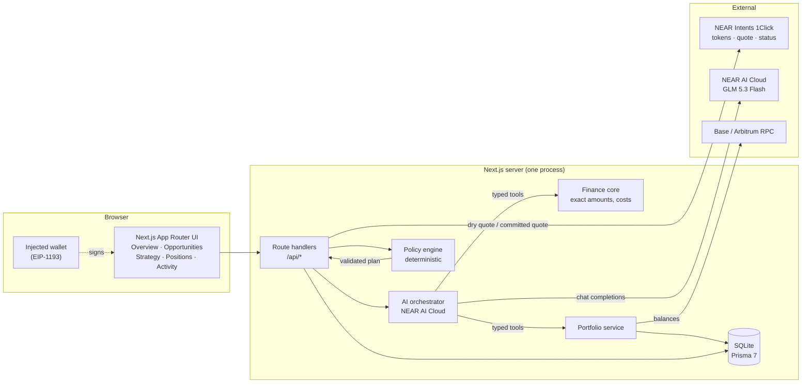

# AI Cross-Chain Portfolio Operator

An AI research agent with a deterministic guardrail engine that sits in front of a non-custodial
cross-chain DeFi portfolio. It tells you where your capital is, proposes where it could go, and
refuses to execute anything the numbers or your own constraints do not support.

Built for the **NEAR Hackathon — `defi` track**. Chains: **Base** and **Arbitrum One**.
Cross-chain settlement and vault access use **NEAR Intents (1Click)**; strategy reasoning uses
**NEAR AI Cloud**.

> **The product's central rule:** the model proposes, deterministic code decides.
> No LLM arithmetic reaches a signature. No quote is presented as an opportunity, and no
> opportunity is presented as executable.

---

## What actually works right now

| Capability | Status | Evidence |
| --- | --- | --- |
| Live 1Click asset catalogue | **Live** | `GET /api/market/tokens` → real 216-asset / 39-chain catalogue, cached 5 min, returns `fetchedAt` |
| Live cross-chain dry quote | **Live** | `GET /api/near/route-preview` → real Base→Arbitrum USDC quote with signature, `correlationId`, quote-derived cost |
| Preview-only quote API | **Live** | `POST /api/near/quote` → always `dry: true`, never returns a deposit address |
| Exact money arithmetic | **Live, tested** | `src/lib/finance/amounts.ts` — `bigint` atomic units, throws rather than rounds |
| Portfolio aggregation | **Live, sample data** | Overview KPIs, allocation, positions — reads a labelled local fixture |
| Opportunity board | **Sample data, labelled** | Rates are fixture rows, not market data; the banner says so |
| Audit log | **Live** | Every seeded/demo event persisted and rendered |
| AI strategy proposal | **Built** | `POST /api/strategy/propose` — typed tools, schema-validated proposal, one repair attempt, labelled deterministic fallback when no key is set |
| Policy engine | **Live, tested** | `src/lib/policy/` — 48 unit tests across the amount, allocation, planner and engine modules (caps, reserve, weights, expiry, arbitrage, 100% caps) |
| Wallet connect + live balances | **Live, read-only** | Injected EIP-1193 connector (no WalletConnect project id); `GET /api/wallet/balances` reads real USDC and ETH balances on Base and Arbitrum at a stated block, with no USD valuation invented |
| Committed quote → deposit → settlement | **In progress** | Non-dry quote, ERC-20 deposit, `/v0/deposit/submit`, status polling |

Anything not marked **Live** is either fixture data (explicitly banner-labelled in the UI) or not
built yet. Nothing is faked. See `AGENTS.md` for the rules that make that non-negotiable.

---

## Architecture



Three boundaries carry the design:

- **`src/lib/finance/` and `src/lib/policy/` are pure.** No I/O, no Prisma, no `fetch`. Every
  number that can move money is computed and checked here, and is unit-tested.
- **`src/lib/near/` is the only place that talks to 1Click.** It validates responses with zod,
  so API drift fails loudly instead of silently producing a wrong amount.
- **`src/lib/ai/` can call tools but cannot execute.** Its output is a schema-validated proposal
  that the policy engine must independently pass.

---

## Run it

Requires Node 20+. No Docker, no database server, no paid account, no API key.

```bash
npm install
npx prisma migrate dev        # creates prisma/dev.db and applies the committed migration
npm run db:seed               # optional: labelled sample portfolio so the UI has content
npm run dev                   # http://localhost:3000
```

### Do this → see that

1. **Open `/`.** You see a portfolio header, four KPIs, an allocation bar and an open-positions
   table. A yellow **Demo mode** banner states that portfolio figures are fixtures. To the right,
   the **NEAR Intents route** card shows a *live* Base→Arbitrum USDC dry quote: quoted output,
   protected minimum, implied cost in bps, settlement estimate and the 1Click `correlationId`.
   The two data provenances are visibly different — that is the point.
2. **Open `/opportunities`.** Four strategy groups with protocol, chain, asset, rate, liquidity
   and observation time. The banner marks them as fixture rows; no rate claims to be a live
   market rate.
3. **Open `/strategy`.** Write an objective and press **Propose allocation**. You get a plan with
   per-leg weights and amounts, the guardrails that produced them (read from
   `StrategyConstraint`, not hardcoded), machine-readable policy findings, and the execution
   trace. Without `NEARAI_API_KEY` the plan comes from the deterministic planner and says so;
   with a key the same request is routed through NEAR AI Cloud. Every proposal — accepted or
   rejected — is persisted and appears in `/activity`.
4. **Press `Connect wallet` in the header.** With a browser wallet installed you get real
   Base/Arbitrum USDC and ETH balances at a stated block number. Without one it says so
   plainly instead of inventing balances. Read-only; it never asks for a signature.
5. **Open `/positions`.** Receipt-token holdings, value, rate and unrealised P&L, plus an explicit
   note that withdrawals are not wired — because pretending otherwise would be a fake feature.
6. **Open `/activity`.** The audit trail of what the system recorded, including the seed event and
   each proposal it evaluated.
7. **Hit `/api/health`.** Live dependency report: database status, active data mode, whether AI
   credentials are present (never the value), whether 1Click is authenticated.
8. **Hit `/api/wallet/balances?address=0x…`.** Live RPC read of USDC and ETH on both chains, with
   the block number and observation time. No USD field: no price source was used.
9. **Hit `/api/near/route-preview`.** A real HTTP call to 1Click. Costs money only in the sense
   that it is free; nothing is signed and no address is created.

### Commands

```bash
npm test              # vitest unit tests
npm run typecheck     # tsc --noEmit
npm run build         # production build
npm run db:studio     # browse the local database
```

On Windows, PowerShell may block `npm.ps1`. Use `npm.cmd` / `npx.cmd`, or prefix commands with
`cmd /c`.

---

## Configuration

Copy `.env.example` to `.env`. Everything is optional except `DATABASE_URL`.

| Variable | Default | Purpose |
| --- | --- | --- |
| `DATABASE_URL` | `file:./prisma/dev.db` | SQLite file location |
| `APP_DATA_MODE` | `sample` | `sample` \| `dry_run` \| `live` — controls which data sources are allowed |
| `NEARAI_API_KEY` | *(empty)* | NEAR AI Cloud key. Without it the AI layer uses its deterministic fallback planner |
| `NEAR_AI_MODEL` | `z-ai/glm-5.3-flash` | 1M context, tool calling, structured outputs, $0.08/$0.50 per M tokens |
| `NEAR_AI_BASE_URL` | `https://cloud-api.near.ai/v1` | OpenAI-compatible base URL |
| `ONECLICK_BASE_URL` | `https://1click.chaindefuser.com` | 1Click API |
| `ONECLICK_JWT` | *(empty)* | Optional partner JWT; public quotes work without it |
| `RPC_URL_BASE` / `RPC_URL_ARBITRUM` | public RPCs | Balance reads |

There is no credential that gates the demo. That is deliberate.

---

## Data provenance

Every externally sourced figure in this product carries **where it came from** and **when it was
observed**. Three data modes are never mixed silently:

| Mode | Meaning | How the UI shows it |
| --- | --- | --- |
| `sample` | Local fixtures, no wallet, no chain read | Yellow **Demo mode** banner + `dataMode` chip |
| `dry_run` | Live reads and live 1Click dry quotes; no funds can move | Quote card shows "dry run", timestamp, `correlationId` |
| `live` | Wallet-signed execution against mainnet | Status timeline with terminal state and audit event |

**1Click has no testnet.** Development is `dry: true` only. A real swap is a tiny mainnet amount
with explicit human approval, recorded in the audit log.

Two empirically verified details worth knowing:

- The documented 25 bps unauthenticated surcharge did **not** match observed behaviour: 100 USDC
  Base→Arbitrum cost ≈2.5 bps. Cost is therefore always derived from `amountIn` vs `amountOut` of
  an actual quote, never from a fee table.
- Earn receipt tokens are not $1. 100 USDC quoted ≈89.035 `gtUSDCp` (≈$1.123/share). Share counts
  come from quotes; a 1:1 assumption would silently misprice every position.

---

## Why the AI is not in charge of the money

The orchestrator can:

- read the portfolio through typed tools,
- read live opportunities and quotes through typed tools,
- propose an allocation with a rationale, per-leg expected outcome and its own risk notes.

The orchestrator cannot:

- perform arithmetic that reaches a transaction,
- relax or reinterpret a guardrail,
- approve its own proposal,
- execute a swap, supply or LP action.

The policy engine independently recomputes sizes and enforces the user's constraints — minimum
liquid reserve, per-protocol / per-asset / per-chain / per-strategy caps, max slippage, max gas and
minimum arbitrage profit. A proposal that fails is returned with machine-readable violations, and
the UI shows them rather than hiding them.

---

## Project layout

```
src/app/            pages + route handlers (Overview, Opportunities, Strategy, Positions, Activity)
src/components/     shell and UI primitives
src/lib/finance/    exact amounts and cost maths (pure, tested)
src/lib/policy/     guardrail engine (pure, tested)
src/lib/near/       1Click client, quote lifecycle, route preview
src/lib/ai/         NEAR AI Cloud orchestrator + typed tools
src/lib/wallet/     injected-wallet balance reads (server, viem)
src/lib/portfolio/  aggregation and valuation
src/lib/db/         Prisma client (driver adapter)
prisma/             schema, migrations, labelled seed
docs/adr/           architecture decisions
docs/agent-skills.md installed agent skills and why
```

Key decisions: [stack](docs/adr/0001-stack.md) ·
[no custom NEAR contract](docs/adr/0002-no-custom-near-contract.md) ·
[dry quotes and human approval](docs/adr/0003-dry-quotes-and-human-approval.md) ·
[MVP scope](docs/adr/0004-mvp-scope.md).

---

## Known limitations

- **Not deployable to a serverless host** with an ephemeral filesystem: SQLite is a local file.
  This is a deliberate trade for reproducibility — see ADR-0001.
- **No 1Click testnet**, so no automated end-to-end test can settle a real swap.
- **Withdraw / redeem / remove-liquidity are not implemented.** The Positions screen says so
  instead of offering a dead button.
- **Lending and LP execution** require direct protocol adapters with verified contract addresses;
  they are the next integration, not a claim in this README.
- **Cross-chain arbitrage is research, not autopilot.** Both legs settle separately; the UI must
  never imply atomicity.
- DeFi returns are variable, principal is not guaranteed, and stablecoins can depeg.

## Licence

MIT — see [LICENSE](LICENSE).
