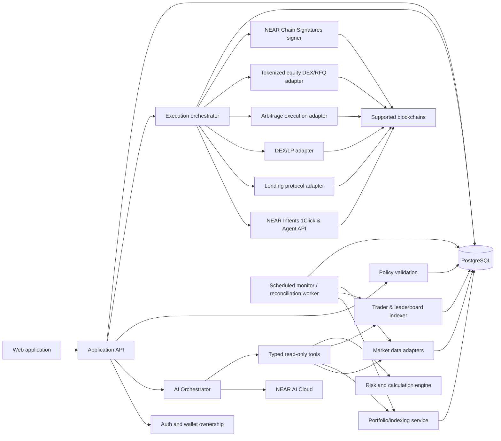

# Capita — AI Cross-Chain Portfolio Operator

## Product, technical and integration specification

**Document type:** Master product and engineering specification  
**Version:** 2.0  
**Updated:** 12 November 2026 (Production scope — includes Tokenized Equities & RWAs)  
**Product name:** Capita  

> **Purpose of this document**  
> This is the product and engineering source of truth for the founder, product/design contributors and coding agents. It explains what the product is, who it serves, what users should be able to do, how each strategy works, what NEAR infrastructure contributes, what other integrations are needed, what must be built for production, and what must not be assumed. Coding agents should read this document before making architectural or product decisions.

---

## 0. Executive summary

**Capita (AI Cross-Chain Portfolio Operator)** is a non-custodial DeFi and real-world-asset (RWA) portfolio management and execution platform for individual crypto holders. It gives users one place to view supported crypto assets, DeFi positions, and tokenized equities across multiple blockchain networks, discover opportunities to put capital to work, receive AI-assisted strategy recommendations, execute approved actions, and monitor the performance of their positions.

The platform focuses on six core strategy categories:

1. **Yield vaults:** Deposit assets into supported third-party yield vaults and receive receipt tokens representing the position.
2. **Lending:** Supply supported assets to lending markets and earn variable interest from borrowers.
3. **Stablecoin liquidity provision:** Supply stablecoins to supported DEX pools and earn a share of trading fees and, where applicable, incentives.
4. **Cross-chain arbitrage:** Discover price discrepancies for the same verified asset across DEX liquidity pools on different chains, calculate execution-aware estimated net profit, and help users execute eligible trades.
5. **Tokenized equities & RWAs:** Buy, hold, track, and sell verified fractionalized tokenized US stocks, ETFs, and commodities (e.g. Dinari `dShares`, Backed `xStocks`, Ondo Stocks, Tether Gold `XAUT`) alongside DeFi positions under explicit NAV-spread, concentration, and issuer-disclosure guardrails.
6. **Cross-chain wallet copytrading (Non-memecoin Spot, Vaults, Lending & LP — All Setup from NEAR):** Inspect any trader wallet/ID across chains or discover ranked top performers, analyze verified positions with AI, and mirror eligible non-memecoin spot trades (via live 1Click) and DeFi vault/lending/LP actions from a single NEAR-funded setup.

The product's main workflow is:

**Connect wallets → View portfolio → Discover opportunities → Choose or create a strategy → Set guardrails → Review → Approve and execute → Monitor and manage.**

AI acts as the research, explanation and strategy-orchestration layer. It interprets the user's goals, gathers current information through structured tools, compares opportunities, proposes allocations and explains risks. Deterministic software—not the language model—calculates returns, validates constraints, simulates transactions and enforces permissions.

NEAR is an essential part of the product's cross-chain infrastructure:

- **NEAR Intents / 1Click Swap API** provides supported cross-chain swap execution through a quote, deposit and status lifecycle—including cross-chain stablecoin (`USDC`) staging into destination equity networks and direct settlement for supported RWAs present in the live `/v0/tokens` catalogue (such as `XAUT`).
- **1Click Earn** extends the same quote lifecycle to supported third-party yield products. A user supplies a supported asset and receives a vault/share receipt token.
- **NEAR Intents Agent API** is an optional mechanism for bounded delegated execution with owner-signed rules, spending limits, approved actions, timelocks and an emergency freeze. It remains gated behind security review and explicit user enablement.
- **NEAR AI Cloud** is the AI inference provider. It exposes an OpenAI-compatible API and provides private inference options, including TEE-hosted models and verification capabilities.

NEAR Intents does not automatically provide every lending, LP, arbitrage, or tokenized-equity swap function. Public 1Click `/v0/tokens` (`230` tokens verified on 12 November 2026) does not directly list tokenized equities, so buying or selling equities uses a **two-step non-atomic rail**: 1Click stages `USDC` onto the destination chain (e.g. Arbitrum One, Ethereum, or Solana), and a destination DEX/RFQ or issuer adapter settles the equity trade. Support must always be checked dynamically against live APIs and verified contract registries.

The product should not be positioned as a guaranteed-profit investment product or a regulated stock brokerage. APYs are variable, arbitrage can lose money, stablecoins can depeg, tokenized stocks carry issuer/custodian and off-hours spread risks, liquidity can disappear, transactions can fail, and smart contracts can be exploited.

---

## 1. Product identity and positioning

### 1.1 Working product description

An AI-powered platform that helps crypto holders manage their cross-chain portfolios, discover DeFi opportunities, allocate capital across supported strategies and execute approved transactions without manually navigating multiple chains and protocols.

### 1.2 Core product promise

> Tell the platform what you want to achieve with your crypto assets. It will assess your portfolio, find suitable opportunities, explain the trade-offs, propose a strategy within your rules, help execute the approved actions across supported chains and track the outcome.

### 1.3 The problem

Crypto holders often have assets spread across multiple chains, wallets, tokens and DeFi protocols. To deploy those assets efficiently, they may need to:

- Connect to different applications and networks.
- Research lending markets, liquidity pools and yield vaults independently.
- Compare APYs that may use different calculation assumptions.
- Assess liquidity, smart-contract risk, token risk and withdrawal restrictions.
- Bridge or swap assets to the network where an opportunity exists.
- Understand gas, protocol fees, slippage and other execution costs.
- Approve several transactions and token allowances.
- Track positions and earnings across different dashboards.
- Decide when a position should be exited, rebalanced or left alone.

This creates fragmentation, increases the amount of research required and makes it difficult to manage a portfolio according to a consistent set of rules.

### 1.4 The solution

The platform combines five capabilities in one product:

1. Cross-chain portfolio visibility.
2. DeFi opportunity discovery and comparison.
3. AI-assisted research and strategy generation.
4. Guardrailed transaction preparation and execution.
5. Cross-strategy performance and position monitoring.

### 1.5 What the product is not

The product is not:

- Merely a crypto price tracker or portfolio tracker.
- Merely a yield aggregator that ranks pools by advertised APY.
- A bridge interface with a chatbot attached.
- A fully autonomous trading bot that can spend without user-defined permissions.
- A lending protocol, DEX or yield vault that must create and own all underlying liquidity.
- A promise that every supported chain, token or DeFi protocol is automatically executable through NEAR Intents.
- A guarantee that the AI can always find profitable or safe opportunities.

### 1.6 Product differentiation

The product's differentiation should be the integrated workflow from **user objective → verified opportunity data → suitable strategy → policy validation → supported on-chain execution → continuing portfolio management**.

The user should not have to stitch together a portfolio tracker, research dashboard, bridge, DEX, lending application and performance spreadsheet for every strategy.

---

## 2. Target users

### 2.1 Primary user segment

**Individual crypto holders and DeFi users with assets across multiple blockchain networks.**

They understand basic crypto ownership and wallet usage but may not have the time, expertise or operational capacity to monitor multiple DeFi applications and manage cross-chain activity manually.

Typical users include:

- A stablecoin holder who wants idle USDC or USDT to earn a return.
- A multi-chain user with assets on Base, Arbitrum, Ethereum, Solana or NEAR.
- A DeFi user who wants to compare lending markets and liquidity pools.
- A trader who wants to discover cross-chain arbitrage without manually searching each DEX.
- A user who already has several DeFi positions and wants a unified performance view.

### 2.2 Core user problems

| User problem | Product response |
|---|---|
| Assets are spread across chains | Unified supported-wallet and asset overview |
| Idle capital is not being deployed | Lending, vault and LP discovery |
| Opportunities are hard to compare | Normalised APY, costs, liquidity, risk and withdrawal information |
| Cross-chain operations are complicated | NEAR Intents / 1Click for eligible routes |
| Arbitrage prices are fragmented | Cross-DEX and cross-chain price-spread scanner |
| AI tools can be unsafe | User-defined allocation policies and execution controls |
| Position performance is fragmented | Unified strategy and position tracking |

### 2.3 Secondary segments — not the initial build focus

DAOs, Web3 foundations and Web3 companies could later use the same financial intelligence and execution layer for treasury management. Their needs differ in important ways: multisig approvals, governance proposals, operating reserves, reporting, role-based access and audit controls. Keep individual portfolio management clean before introducing DAO/multisig workflows.

### 2.4 Initial user assumptions to validate

- Users are willing to connect one or more self-custodial wallets.
- Users want an application that recommends but does not initially execute major financial actions without explicit approval.
- Users value net returns and risk context more than the highest headline APY.
- Users want to manage several strategy types from one dashboard.
- Users will accept a limited set of supported protocols if the integrations are reliable and transparent.

---

## 3. Product principles

All design and implementation decisions should follow these principles.

1. **User custody first.** Never ask users to paste seed phrases or private keys into the application. Wallet signing and supported NEAR agent authorisations must use documented wallet flows.
2. **Explain every financial action.** Show what asset leaves, what asset/position is received, which protocol and chain are involved, costs, expected output, risk and exit method.
3. **No invented financial data.** APY, TVL, prices, liquidity, fees and transaction status must come from data providers, on-chain reads or execution quotes.
4. **Net figures over headline figures.** Where possible, show estimated net return after known fees and execution costs, and state which costs are not included.
5. **AI proposes; deterministic code verifies.** The LLM cannot authoritatively calculate P&L, approve its own policy checks or directly sign transactions.
6. **Execution is conditional on fresh quotes.** An opportunity discovery result is not an executable quote. Refresh the relevant protocol/DEX quote immediately before execution.
7. **No universal-chain claims.** Show only assets, markets and routes that are supported by the relevant integration at the time of the request.
8. **No false atomicity.** A NEAR Intents swap may be atomically verified as an intent settlement, but that does not make a multi-DEX arbitrage strategy spanning separate transactions atomic.
9. **Safety defaults to approval.** Autonomous execution is an opt-in future capability with bounded permissions, not the default.
10. **Build a coherent product, not a collection of demos.** Every module must contribute to managing, allocating, executing or monitoring the user's portfolio.

---

## 4. Core financial strategies

The first release is organised around four strategy categories. These are the initial supported investment/DeFi workflows, not a claim that the product already supports every protocol in each category.

### 4.1 Strategy A — Yield vaults

#### What it is

A yield vault accepts a user's deposit and deploys capital according to a strategy defined by the vault operator or protocol. The user normally receives a fungible receipt/share token representing their position. The vault may use lending, liquidity provision or other DeFi strategies underneath.

**Important classification rule:** a vault may itself lend assets or provide liquidity. The product must identify the underlying strategy where data is available and must not double-count the vault's underlying exposure as a separate direct lending/LP position.

#### What the user can do

- Discover supported yield vaults.
- Filter by asset, chain, protocol, APY, TVL/liquidity, withdrawal terms and risk indicators.
- Open a vault details view and inspect its underlying strategy.
- Enter an amount and request a current deposit quote.
- Review fees, expected receipt-token output, withdrawal method and risks.
- Approve and deposit.
- View the receipt-token position and its estimated underlying value.
- Request a withdrawal/redeem quote and withdraw when supported.
- Monitor the position's performance over time.

#### How the platform finds opportunities

1. Retrieve the currently supported 1Click token catalogue.
2. Identify receipt assets associated with supported vault products.
3. Retrieve yield metadata from an appropriate data provider (NEAR's 1Click Earn documentation refers integrators to Yield.xyz for APY and yield metadata).
4. Validate that the receipt asset and the intended input/output assets are currently supported.
5. Request a fresh quote for the user's amount before presenting an executable action.
6. Display the source and timestamp of APY data separately from the execution quote.

#### NEAR integration

**NEAR Intents 1Click Earn** uses the standard 1Click quote lifecycle; it is not a separate universal yield-deposit API.

Documented flow:

1. `GET https://1click.chaindefuser.com/v0/tokens` to resolve supported asset IDs.
2. `POST https://1click.chaindefuser.com/v0/quote` to quote a deposit or withdrawal.
3. For a normal origin-chain deposit, the user transfers the source asset to the quote's `depositAddress`.
4. Track the lifecycle through `GET https://1click.chaindefuser.com/v0/status?depositAddress=...`.
5. On withdrawal, reverse the asset direction: receipt token is the origin asset and the payout token is the destination asset.

For a deposit, `originAsset` is the payment asset and `destinationAsset` is the receipt token. For a withdrawal, those asset roles reverse. The quote includes delivery/refund fields such as `depositType`, `recipientType`, `recipient`, `refundTo`, `refundType` and an expiry deadline.

The Earn documentation currently lists a limited set of example receipt assets, including:

- `gtUSDCp` — Gauntlet USDC Prime (Morpho), Base.
- `TLO` — Taler USDC, Ethereum.
- `kV-gtSOLb` — Kamino SOL, Solana.

This list can change and is not a promise of permanent support. **The live `/v0/tokens` catalogue and a successful quote are authoritative.** Never hardcode the catalogue as permanently available.

The 1Click API does not return APY. The official Earn guide points integrators to Yield.xyz's `List yields` and `Get a yield` endpoints for APY and yield metadata. Yield metadata is third-party and is not guaranteed by 1Click.

NEAR Intents coordinates the route; it does not operate the underlying yield protocol, set the APY or guarantee principal.

#### Risks and disclosures

- Smart-contract and vault strategy risk.
- Protocol, curator and operator risk.
- Receipt-token price/exchange-rate changes.
- Withdrawal delay, liquidity constraints or caps.
- Underlying asset depeg or volatility.
- APY variability and incentive programme changes.
- 1Click route availability and execution fees.

The UI must display that yield and principal are not guaranteed.

---

### 4.2 Strategy B — Lending

#### What it is

A user supplies an asset to a lending protocol. Borrowers use the liquidity and pay interest. The supplier earns a variable supply rate, usually represented by an on-chain position/share token or protocol accounting entry.

Examples of protocols to research for an initial integration include Aave and Rhea. These are candidates, not automatically approved integrations. Select the first lending market only after checking chain deployment, asset availability, supply APY data, liquidity, integration documentation and direct transaction feasibility.

#### What the user can do

- View lending markets by chain, asset and protocol.
- Compare current supply APY, market liquidity, utilisation and incentives.
- Inspect whether the rate is variable or otherwise defined by the protocol.
- Deposit/supply a supported asset.
- View supplied balance and accrued/claimable return.
- Withdraw supplied assets where liquidity and protocol rules permit.
- Compare markets by estimated net yield and risk indicators.

#### How the platform finds and evaluates markets

1. Read market/reserve information from the lending protocol's official API/SDK or on-chain contracts.
2. Read current supply rate, available liquidity, utilisation, caps, incentives and reserve parameters where available.
3. Read protocol documentation and risk parameters for the relevant market.
4. Check the user's chain and token balance.
5. Calculate a comparable estimate using a consistent APR/APY convention.
6. Estimate transaction gas and any cross-chain routing costs.
7. Apply the user's restrictions and rank suitable markets.

Do not rely solely on an aggregator's headline APY if official protocol data is available. If aggregator data is used, show the provider and timestamp and cross-check critical values.

#### Execution architecture

NEAR Intents can move or swap supported assets across chains. It does **not** automatically supply assets to every lending protocol.

A lending workflow may therefore contain two separately authorised steps:

1. Move/swap the user's asset to the required network/token using 1Click if a compatible route exists.
2. Call the lending protocol's supply/deposit contract or official SDK on the destination chain.

The lending deposit and the 1Click swap are not automatically one atomic transaction. The UI must show the step-by-step state and handle partial completion.

For Aave, the official documentation provides AaveKit TypeScript/React/GraphQL integration options and direct smart-contract integration. The specific Aave market version and network must be selected before implementation.

#### Risks and disclosures

- Smart-contract and protocol risk.
- Variable APY and rate changes.
- Borrower default/bad-debt and liquidation system risk, depending on protocol design.
- Withdrawal liquidity constraints.
- Stablecoin depeg or underlying asset volatility.
- Chain gas and routing costs.
- Incentive-token emissions that may not persist.

A high utilisation rate can mean higher lending rates but may also mean lower immediate withdrawal liquidity. Do not label a higher lending APY as automatically safer or better.

---

### 4.3 Strategy C — Stablecoin liquidity provision

#### What it is

A user deposits two stablecoins into a DEX liquidity pool (for example, a USDC/USDT pool). Traders pay fees when swapping through the pool. Liquidity providers receive their share of applicable trading fees and, depending on the pool, incentives.

Stablecoin-to-stablecoin pools often have lower price divergence than volatile-token pairs, but they are not risk-free. Stablecoins can depeg, pools can become imbalanced and LP positions can lose value relative to simply holding the assets.

#### What the user can do

- Discover supported stablecoin pools.
- Compare pool liquidity/TVL, volume, fee tier, historical fee generation, incentives and token composition.
- Inspect whether the pool is a constant-product, stable-swap or concentrated-liquidity design.
- See which token amounts are needed to enter the pool.
- Simulate the deposit and expected LP/share position.
- Approve and add liquidity.
- Monitor token amounts, current position value, fees earned, incentive rewards and impermanent loss/relative performance where calculable.
- Remove liquidity and collect fees where supported.

#### Data and calculation requirements

For each pool, store:

- Chain/network ID.
- DEX and protocol version.
- Pool contract address.
- Token0 and token1 contract addresses (not just symbols).
- Token decimals.
- Pool type and fee tier.
- Total liquidity/TVL and recent trading volume.
- Current price and pool state.
- Historical fee/reward data where available.
- Timestamp and provenance for each market datum.

For a concentrated-liquidity pool, the position can be range-based and represented by an NFT. The position's value and fee earnings depend on whether it is in range and on its price path. The platform must not treat all LP positions as interchangeable fungible deposits.

#### Execution architecture

NEAR Intents may be used to move or swap the user's assets to the necessary network or token, if the route is supported. **The actual LP operation requires direct integration with the DEX's liquidity-management contracts or SDK.**

For Uniswap V3, official developer guidance uses the Uniswap V3 SDK and `NonfungiblePositionManager` to mint, increase, remove and collect fees for NFT-based positions. Uniswap V4 has a different position-manager and action-encoding model. Do not mix V3 and V4 code paths.

Select one DEX version and one stablecoin pool for the first execution integration. Verify the real deployed addresses, pool state, supported token list, router/position-manager address and transaction simulation before allowing a user transaction.

#### Risks and disclosures

- Stablecoin depeg and issuer risk.
- Smart-contract and DEX risk.
- Pool imbalance and liquidity risk.
- Concentrated-liquidity out-of-range risk (where relevant).
- Impermanent loss/relative underperformance.
- Fee revenue variability.
- Incentive programmes may change or end.
- Token approvals and transaction failures.

Do not describe stablecoin LP as risk-free or guarantee a displayed fee APY.

---

### 4.4 Strategy D — Cross-chain arbitrage

#### What it is

Cross-chain arbitrage attempts to exploit price differences for the same asset across DEX liquidity pools on different blockchain networks.

Illustrative example:

- A verified token trades for $1.00 on DEX A on Base.
- The exact same token (same canonical asset/contract on that chain or a correctly verified bridged representation) trades for $1.03 on DEX B on Arbitrum.
- The apparent gross spread is 3%.
- The system estimates whether the spread remains positive after DEX fees, slippage, gas, routing/bridge costs and execution uncertainty.

A visible price difference is not proof of profit. Prices must be evaluated at the intended trade size and with live executable quotes.

#### What the user can do

- Open an arbitrage explorer.
- Filter by token, chain pair, DEX, minimum net-profit estimate and maximum capital.
- See buy venue, sell venue, route, market prices, pool liquidity, volume and data timestamps.
- Enter trade size and recalculate the expected output.
- Review a full cost breakdown.
- View the risk/feasibility explanation.
- Simulate the opportunity without sending funds.
- Execute only if the complete route and transaction sequence are implemented and revalidated.
- Track each leg and calculate realised P&L after completion.

#### Opportunity detection

1. Maintain an allowlist of supported chains and DEXs.
2. Maintain a verified token registry using chain ID + contract/mint address + decimals + canonical asset mapping. Never match tokens by symbol alone.
3. Discover candidate pools using a pool-data provider such as DEX Screener or GeckoTerminal.
4. Fetch pool reserves/state, liquidity, recent volume and price.
5. Identify candidate price gaps for the same verified asset.
6. Obtain trade-size-specific executable quotes from DEX quote/Quoter/router APIs or validated on-chain quote calls.
7. Estimate fees, gas, slippage, bridge/routing costs and capital-rebalancing costs.
8. Reject stale, illiquid, unsupported, mismatched or non-profitable opportunities.
9. Present an opportunity with source timestamps and assumptions.

DEX Screener and GeckoTerminal should be treated as discovery/data sources. Their displayed spot prices are not enough to authorize a trade. Final execution calculations must use fresh protocol-specific quotes or on-chain state.

#### Profit calculation

For a closed arbitrage cycle:

```text
realised_net_pnl_usd =
    realised_exit_value_usd
  - realised_entry_cost_usd
  - buy_dex_fee_usd
  - sell_dex_fee_usd
  - gas_cost_usd
  - bridge_or_intents_fee_usd
  - other_execution_costs_usd
```

For an opportunity before execution:

```text
estimated_net_profit =
    expected_sell_output
  - expected_buy_input
  - estimated_buy_fee
  - estimated_sell_fee
  - estimated_gas
  - estimated_cross_chain_cost
  - estimated_rebalance_cost
  - slippage_buffer
  - execution_risk_buffer
```

The UI must distinguish estimated profit from realised profit. Do not represent a live spread as guaranteed returns.

#### Crucial NEAR Intents limitation

NEAR Intents/1Click is a cross-chain swap and settlement rail. It is not, by itself, a cross-chain arbitrage discovery engine and does not automatically execute two independent DEX trades as one atomic arbitrage cycle.

A cross-chain arbitrage strategy can involve at least two DEX legs, potentially on separate chains, plus subsequent inventory rebalancing. Those legs can have different execution times and failure modes. A successful 1Click settlement does not guarantee that a separate DEX sale executes profitably.

Two models can be evaluated:

**Model 1 — Sequential trade and transfer**

1. Buy the token on Chain A.
2. Use NEAR Intents to transfer/swap it to the required asset/chain.
3. Sell on Chain B.

This is easy to explain but exposes the user to price movement while the cross-chain step is pending. It is not an atomic round trip.

**Model 2 — Pre-positioned inventory**

1. User holds sufficient quote/base assets on both chains.
2. The system detects a spread.
3. It executes the buy and sell legs on each chain under the user's approvals.
4. It reconciles balances and uses NEAR Intents for later inventory rebalancing when supported.

This can reduce the delay caused by bridging between the buy and sell legs, but the two trades still may not be atomic. Partial fills and one-leg-only execution are possible.

The platform must provide an opportunity scanner with deterministic net-profit estimates, fresh quote checks, simulation and transaction-ready execution for paths that can be validated. Do not claim full automated arbitrage execution unless both legs, failure handling and accounting work end-to-end.

#### Risks and disclosures

- Price moves during execution.
- DEX slippage and liquidity depth.
- MEV and adverse execution.
- Partial fill or one leg failing.
- Bridge/solver delay or route failure.
- Token contract mismatch or malicious token.
- Gas spikes and transaction replacement.
- Insufficient capital on one chain.
- Rebalancing cost can erase the spread.

---

### 4.5 Strategy E — Tokenized equities & RWAs

#### Overview

Users can buy, hold, track, and sell verified fractionalized tokenized US stocks, ETFs, and commodities (e.g. Nvidia, Apple, Tesla, S&P/Nasdaq ETFs, and tokenized gold) inside the same self-custodial portfolio that holds their crypto and DeFi yield positions.

Unlike standalone stock-basket apps, Capita positions tokenized equities as a **policy-capped sleeve alongside productive DeFi capital** (for example: keeping 30% liquid USDC, earning yield on 50% in vaults/lending, and allocating 20% or harvested yield into tokenized US equities).

#### Real-world asset issuers and chain availability

- **NEAR Intents 1Click live `/v0/tokens` check (verified 12 November 2026):** Out of `230` listed tokens, **zero** tokenized stocks or equity ETFs are exposed natively in the public 1Click catalogue. Tokenized gold (`XAUT` on Ethereum, `0x68749665ff8d2d112fa859aa293f07a622782f38`) is the closest live commodity RWA in `/v0/tokens`. Meanwhile, ticker collisions exist in `/v0/tokens` (for example, `SPX` on Ethereum and Solana at `~$0.35` is the SPX6900 memecoin, not the S&P 500).
- **Destination on-chain issuers:**
  - **Arbitrum One:** Dinari `dShares` (e.g. `NVDA.d`, `AAPL.d`) and Backed `xStocks` (`AAPLx`).
  - **Ethereum:** Ondo Stocks (`NVDAon`, `AAPLon`, `TSLAon`) and Tether Gold (`XAUT`).
  - **Solana (planned multi-chain expansion):** Backed `xStocks` (Token-2022 mints such as `NVDAx`) and Ondo Stocks.

#### How execution works (Two-step non-atomic rail)

Because public 1Click routes settle crypto/stablecoins and `XAUT` rather than third-party equity tokens directly:

1. **Buy equity flow:**
   - **Step 1 (1Click Staging):** Use NEAR Intents 1Click to consolidate/bridge user `USDC` from the origin chain (e.g. Base) to the destination chain where the verified stock token trades (e.g. Arbitrum One or Ethereum).
   - **Step 2 (Destination Equity Swap):** Request a fresh quote from a verified DEX aggregator, RFQ venue, or issuer adapter (e.g. 0x / CoW / Uniswap / issuer router), verify NAV spread guardrails, display token approval/spender details, and request user wallet signature to swap `USDC` → verified equity token.
2. **Sell equity flow:**
   - **Step 1 (Equity Unwind):** Swap the tokenized equity back to `USDC` on the destination chain with user approval and NAV-spread verification.
   - **Step 2 (Optional 1Click Repatriation):** Move settled `USDC` back to the user's preferred chain or into a DeFi yield vault via 1Click.
3. **Strict non-atomicity:** Both legs have independent confirmations, quotes, and failure states. If Step 1 succeeds and Step 2 fails a spread guardrail (e.g. off-hours illiquidity), the user retains settled `USDC` safely on the destination chain.

#### Dual price provenance and market-hours rules

Traditional equity markets trade during regulated exchange hours (09:30–16:00 ET Monday–Friday, plus extended sessions), whereas on-chain DEX pools trade 24/7:

- Every equity listing and position must store **both**:
  1. **TradFi Reference NAV:** Underlying stock/ETF market price, exchange session state (`OPEN`, `EXTENDED`, `CLOSED`), data provider, and observation timestamp.
  2. **On-chain Execution Price:** Live DEX/RFQ quote price and pool liquidity depth.
- **Off-hours spread check:** Deterministic calculation `navDeviationBps = abs(execPrice - refNav) / refNav * 10000`. Trades exceeding the user's `maxNavDeviationBps` (default e.g. `75 bps`) or occurring while markets are `CLOSED` (when `allowOffHoursExecution = false`) are blocked by the policy engine.

#### Corporate actions, custody, and compliance disclosures

- **Wrapper differences:** Explicitly tag whether a token is `total_return_reinvesting` (e.g. Ondo `.on` tokens reinvesting net dividends into redemption value) vs `price_tracker` or issuer-specific dividend handling, and note that tokenized equities do not confer shareholder voting rights unless stated by the issuer.
- **Issuer/custodian counterparty risk:** Underlying shares are held by regulated custodians/SPVs under the issuer's legal structure, unlike trustless native crypto.
- **Transfer & jurisdiction restrictions:** Certain issuers restrict transfers to allowlisted/KYC wallets or exclude residents of specific jurisdictions (such as the US and Canada). Eligibility status and issuer disclaimers must be surfaced before execution.

#### End-to-end product scenario (Core DeFi Yield + Policy-Capped Equity Sleeve)

1. **Portfolio:** User holds `$6,000 USDC` + `0.8 ETH` on Base and `$2,500 USDC` + `0.02 WBTC` on Arbitrum One.
2. **Guardrails:** `minLiquidPercent = 30%`, `maxRwaExposurePercent = 20%`, `maxNavDeviationBps = 75`, `allowOffHoursExecution = false`.
3. **AI Strategy Proposal:** User asks to keep 30% liquid, earn yield on 50%, and invest 20% into Nvidia and Apple equities. AI returns basis-point weights (`50%` Base yield vault, `10%` Arbitrum `NVDA.d`, `10%` Arbitrum `AAPL.d`); deterministic code verifies reserve, RWA cap, NASDAQ `OPEN` session, `+18 bps` spread (`<= 75 bps`), and verified contract addresses.
4. **Two-Step Execution:** User approves Leg 1 (`1Click` moves `$1,000 USDC` Base → Arbitrum to stage funds cleanly) and Leg 2 (Arbitrum DEX/RFQ swaps `$1,000 USDC → NVDA.d` and `$1,000 USDC → AAPL.d` after reviewing issuer/custody notice).
5. **Positions & Exit:** User tracks atomic fractional shares, cost basis, Reference NAV, live exit value, and can sell any equity back to `USDC` (and optionally bridge to Base via 1Click) in one guided flow.

#### Risks and disclosures

- Issuer, broker-dealer, and SPV custodian insolvency or regulatory halt risk.
- Off-hours liquidity thinning causing severe DEX premiums or discounts versus Reference NAV.
- Dividend tax withholding and corporate-action tracking divergence.
- Transfer/allowlist reverts on non-compliant wallets or regional geo-restrictions.
- Ticker spoofing or malicious lookalike ERC-20/SPL tokens (prevented by `(chainId, contractAddress)` verification).

---

### 4.6 Strategy F — Cross-chain wallet copytrading (Spot blue-chips, vaults, lending & LP — all setup from NEAR)

#### Overview & asset scope

Users can search **any cross-chain trader address or domain** (`0x...`, `.eth`, `.sol`, `.near`) or browse a curated **Top Performers** leaderboard across chains, inspect the trader's verified live holdings and DeFi positions through an AI briefing, and mirror either a one-time portfolio snapshot or ongoing trades—**all funded and configured once from NEAR**.

**Trading type & strict non-memecoin scope:**
- **Included:** Spot cross-chain allocations across major verified tokens and RWAs (`~184` non-memecoin assets live in 1Click `/v0/tokens` such as `ETH`, `WETH`, `WBTC`/`cbBTC`, `SOL`, `NEAR`, `AAVE`, `UNI`, `LINK`, `ARB`, `GMX`, `OP`, `SUI`, `AVAX`, `XAUT`, `USDC`/`USDT`/`DAI`), **1Click Earn vaults** (`gtUSDCp`, `sparkUSDC`, `mwUSDC`, `steakUSDC`, `kV-gtSOLb`), **Aave V3 lending supplies**, and **Uniswap V3 / Aerodrome LP entries**.
- **Explicitly excluded:** **Zero memecoins.** Memecoins, unverified micro-cap DEX tokens, and opaque high-frequency MEV flows are deterministically excluded from discovery rankings and blocked by the policy engine.
- **Perps clarification:** 1Click settles **spot and vault tokens**, not leveraged perpetual futures. While 1Click bridges `USDC` to chains such as `hypercore`, perp copytrading requires a separate future perp adapter (`Hyperliquid` / `GMX`) and must never be conflated with spot 1Click execution.

#### Data platforms & wallet discovery sources

Because trader activity is scattered across networks, Capita pulls normalized multi-chain telemetry from specialized indexers and verifies on-chain state before execution:

1. **Instant Wallet X-Ray (user-entered address or ID):**
   - **Zerion API:** Cross-chain token balances, Aave lending supply/borrow positions, Uniswap LP positions, decoded swap history, and PnL across EVM + Solana.
   - **DeBank Cloud OpenAPI:** Deep EVM wallet profiling, protocol stakes, health factors, and claimable rewards.
   - **Sim by Dune API:** Multi-chain EVM + Solana analytics, block-level snapshots, Uniswap V3 LP fee vs. impermanent-loss breakdown, and Aave health factors.
   - **Direct RPC verification (`viem`):** Confirms exact `(chainId, contractAddress)` identity and live state before any execution quote is requested.
2. **Cross-chain Top Performers leaderboard:**
   - Curated via **Sim by Dune / Dune pipelines** and **Zerion / DeBank** wallet feeds, deterministically filtering out MEV bots, exchange hot wallets, wash traders, and memecoin-heavy wallets. Ranks traders by realized return, win rate, drawdown, average hold duration, and traded asset liquidity.

#### AI Wallet X-Ray & unified NEAR execution setup

1. **Wallet X-Ray (Deterministic metrics + NEAR AI Cloud):**
   - Deterministic code computes win rate, realized PnL, drawdown, and strategy breakdown (`spot` vs `vaults` vs `lending` vs `LP`), ensuring zero fabricated performance stats.
   - NEAR AI Cloud translates those facts into a clear summary explaining what chains/protocols the trader uses and flagging uncopyable legs (such as Aave borrow debt or unknown off-chain/perp hedges).
2. **Unified NEAR setup & dual execution modes:** Users fund **one** NEAR setup (`USDC` in a NEAR Intents / Agent wallet) instead of maintaining fragmented gas and stablecoin balances across five chains:
   - **Mode A — Copy-with-Approval (Non-Custodial):** When a followed wallet executes an eligible move (or user clicks **Mirror Current Portfolio**), Capita prepares the verified quote and prompts for explicit user approval.
   - **Mode B — Automated Rule-Bound Copy (NEAR Intents Agent API + Chain Signatures):** User signs owner-authorized **NEAR Intents Agent API** spending rules from NEAR (`maxUsdPerCopyTrade`, `maxDailyCopyBudgetUsd`, `copyScaleBps`, `maxPriceDriftFromLeaderBps`, `noMemecoinsOnly`, and instant kill-switch):
     - **Spot & 1Click Earn vaults (`gtUSDCp`, `sparkUSDC`, `steakUSDC`, etc.):** Executed directly cross-chain via **NEAR Intents 1Click / Agent API** in **one step**.
     - **Lending (Aave V3) & LP (Uniswap V3):** Executed via a **two-step non-atomic rail**: 1Click stages the required token onto Base/Arbitrum/Ethereum, and **NEAR Chain Signatures** (or connected wallet) signs the verified `supply()` or `mint()` call on the destination contract matching the leader's pool and price range.

#### Risks and disclosures

- **Latency & price drift ("exit liquidity"):** Between a leader's transaction block and follower execution, asset price can move against the follower (mitigated deterministically by `maxPriceDriftFromLeaderBps` and excluding illiquid tokens/memecoins).
- **Spot-only visibility / hidden hedges:** An indexed on-chain wallet buying spot `ETH` or `WBTC` may be delta-hedged short on a CEX or perp exchange; Capita cannot see external CEX accounts and warns users explicitly before copying.
- **Lending/LP asymmetry:** Mirroring a leader's collateral supply without their debt management or rebalancing cadence can diverge; high-leverage borrow loops are blocked by default.
- **Past leader performance:** Historical wallet returns never guarantee future profits, and copytrading fees/slippage reduce net return vs the leader's fills.

---

## 5. Product modules and user-facing functionality

The application should be organised into the following modules.

### 5.1 Wallet connection and supported accounts

Users connect their own wallet(s). The product must support only wallets/chains that are actually integrated and tested.

Initial recommendation:

- Start with EVM wallet support for the first execution workflows.
- Consider Reown AppKit for multichain wallet connection across EVM and Solana, subject to its current integration, package and licensing terms.
- Use `wagmi`/`viem` for EVM contract reads, writes, chain IDs and transaction handling.
- Add Solana adapters only when a Solana strategy is in the tested scope.

Wallet connection must not imply the application can spend funds without a signature or explicitly authorised agent policy.

### 5.2 Portfolio dashboard

The dashboard aggregates, for all linked and supported accounts:

- Total portfolio valuation.
- Per-chain balances.
- Per-token balances.
- Available/unallocated capital.
- Deployed capital by strategy.
- Lending positions.
- LP positions.
- Vault receipt-token positions.
- Open and completed arbitrage trades.
- Realised and unrealised P&L.
- Accrued yield and earned fees.
- Recent transactions and transaction status.

Every balance and valuation should be timestamped. Show unsupported assets separately rather than silently omitting them.

### 5.3 Opportunity Explorer

A common discovery interface with strategy tabs:

- Yield vaults.
- Lending markets.
- Stablecoin LP pools.
- Cross-chain arbitrage.
- Tokenized equities & RWAs.
- Copytrading (Wallet X-Ray & Top Performers — zero memecoins).

Each opportunity card should contain at least:

- Strategy type.
- Protocol/DEX/issuer and chain.
- Asset or pair contract addresses and symbols (for RWAs: underlying ticker, issuer name, and wrapper type).
- Estimated APY/APR or net trade profit, as applicable (for equities/RWAs: never label historical stock return as APY; show Reference NAV, live on-chain quote, and spread in bps).
- Market session status for RWAs (`OPEN`, `EXTENDED`, `CLOSED`) plus data source and last updated timestamp.
- Liquidity/TVL and volume where relevant.
- Fees, withdrawal constraints, and issuer/jurisdiction eligibility notes where available.
- Risk indicators and missing data flags.
- A details view and a fresh-quote action before execution.

Do not rank solely by headline APY. Ranking should consider the user's constraints, costs, liquidity, volatility, protocol risk and data confidence.

### 5.4 AI Strategy Builder

The user can describe a goal in natural language or choose a guided strategy form.

Example:

> I have $5,000 in USDC across Base and Ethereum. Keep at least 30% liquid, prioritise established lending markets and stablecoin LP opportunities, do not allocate more than 20% to a single protocol, and only recommend opportunities with enough liquidity for me to exit.

The system should:

1. Parse the goal and constraints into a typed strategy request.
2. Fetch the current portfolio snapshot.
3. Retrieve eligible opportunities from read-only tools.
4. Calculate possible allocations using deterministic functions.
5. Validate the plan against all user constraints.
6. Explain the rationale, risks, costs and unavailable information.
7. Return a structured plan that the UI can render.

The user can edit the plan before execution. An LLM-generated recommendation is not an approval.

### 5.5 Execution Center

Execution is a separate stage from discovery and strategy design.

The execution center should:

- Refresh every relevant quote.
- Check quote expiry and supported chain/asset routes.
- Recalculate output and net return.
- Validate user limits and permissions.
- Display token approvals, spender addresses and transaction actions.
- Request wallet approval for each required transaction, unless an explicitly enabled and supported agent authorisation handles the action.
- Submit the transaction/deposit.
- Track transaction hashes and 1Click status.
- Handle pending, success, refund, failure and incomplete deposit states.
- Reconcile the actual resulting balances/positions.

### 5.6 My Strategies / Position Management

Users must be able to view each active position and its source strategy.

For each position show:

- Initial deposited capital.
- Current position value.
- Current underlying assets or receipt tokens.
- Current APY/APR and rate timestamp if available.
- Accrued interest/fees/rewards (or equity price return & corporate-action/dividend adjustment, explicitly separated).
- Realised P&L.
- Unrealised P&L.
- Fees and incentives earned.
- Chain, protocol, and (for RWAs) issuer/wrapper identity.
- Entry transaction and explorer link.
- Withdrawal or unwind path (including two-step sell → USDC → bridge) and current restrictions.
- Relevant risk and health indicators (including live Reference NAV vs exit spread for tokenized equities).

Available actions should include:

- View details.
- Refresh position data.
- Add capital / buy additional fractional shares (if supported).
- Withdraw/remove liquidity/redeem/sell back to USDC (if supported).
- Pause automated monitoring or future execution (including freezing copytrading subscriptions).
- Close/terminate a strategy (subject to the protocol's actual exit procedure).
- Export transaction history.

### 5.7 Alerts and monitoring

Possible alerts:

- APY falls below a user's threshold.
- Lending utilisation or available liquidity changes materially.
- Pool TVL or volume falls below a configured level.
- Stablecoin deviates from its peg threshold.
- LP position moves out of range.
- Yield vault withdrawal/receipt conversion changes.
- Tokenized equity off-hours spread exceeds `maxNavDeviationBps` or issuer pauses/restricts transfers.
- Followed leader wallet makes an eligible trade (prompting Copy-with-Approval or reporting auto-copy execution), or a copy leg is blocked due to `maxPriceDriftFromLeaderBps` or excluded memecoin/debt detection.
- Strategy exposure exceeds a limit.
- Arbitrage route is no longer profitable.
- Transaction is pending too long, refunded or failed.

Alerts must be based on explicit thresholds and data provenance. AI can explain the alert but deterministic rules should trigger it.

---

## 6. Complete end-to-end product flow

```mermaid
flowchart TD
    A[User connects supported wallet(s)] --> B[Portfolio indexer reads balances and positions]
    B --> C[Unified portfolio dashboard]
    C --> D[User opens Opportunity Explorer or describes a goal]
    D --> E[AI strategy orchestrator]
    E --> F[Read-only market and protocol tools]
    F --> G[Deterministic opportunity, cost and risk calculations]
    G --> H[Structured proposed strategy]
    H --> I[Policy and guardrail validation]
    I --> J{All constraints satisfied?}
    J -- No --> K[Explain violation and revise plan]
    K --> H
    J -- Yes --> L[Refresh executable quotes and simulate]
    L --> M[Display final transaction plan]
    M --> N{User approves?}
    N -- No --> O[Save draft / discard]
    N -- Yes --> P[Wallet signing or authorised Agent API action]
    P --> Q[NEAR Intents 1Click and/or direct protocol transaction]
    Q --> R[Track chain and protocol states]
    R --> S[Reconcile balances and positions]
    S --> T[Update strategy performance and alerts]
```

### 6.1 Important separation of operations

The app should distinguish:

- **Discovery:** Find a possible opportunity from available market data.
- **Analysis:** Evaluate costs, risk and suitability.
- **Quote:** Request a current executable route from the protocol/DEX.
- **Preparation:** Construct the transaction plan and verify guardrails.
- **Approval:** User or authorised agent grants permission.
- **Execution:** Send the relevant transaction(s).
- **Settlement:** Confirm the protocol/chain has completed the action.
- **Reconciliation:** Read final balances and positions; compute actual P&L.

Do not represent discovery as execution readiness. Do not represent a submitted transaction as a completed strategy.

---

## 7. NEAR infrastructure and how the product uses it

This section documents actual NEAR capabilities and the intended use in this product. Coding agents must use official documentation and must not invent endpoints or assume features that are not documented.

### 7.1 NEAR Intents

**Purpose:** Chain-abstracted swap and settlement infrastructure. Users specify the asset they have, the asset they want and where the result should be delivered. Market makers compete to fulfil the intent. Approved execution is verified through the protocol's smart-contract infrastructure.

Product use:

- Convert a source asset into a destination asset across supported networks.
- Move funds to a chain where a selected DeFi opportunity exists, when the desired token/route is supported.
- Execute eligible swaps without forcing users to manually select and manage a traditional bridge route.
- Support cross-chain asset rebalancing after strategy actions.

Important limits:

- Chain support does not imply every token or route is available.
- Token and route support must be checked through the live API and a fresh quote.
- Intents are not a universal adapter for every protocol action.
- A successful cross-chain swap does not automatically execute a separate lending supply, LP deposit or second leg of an arbitrage strategy.
- Atomicity guarantees apply to the documented intent settlement, not to an application's multi-step financial strategy as a whole.

Official documentation: [What are Intents?](https://docs.agentsonintents.com/getting-started/what-are-intents), [Supported Chains](https://docs.agentsonintents.com/resources/chain-support).

### 7.2 1Click Swap API

**Purpose:** A REST interface that automates quote requests, solver/market-maker coordination, swap construction and execution tracking.

Base URL:

```text
https://1click.chaindefuser.com
```

Core endpoints used by the documented flow:

```text
GET  /v0/tokens
POST /v0/quote
POST /v0/deposit/submit   (optional transaction-hash notification)
GET  /v0/status?depositAddress=...
```

Typical execution lifecycle:

1. Call `/v0/tokens` and select an exact `assetId`.
2. Call `/v0/quote` with source/destination assets, amount, swap type, slippage tolerance, deposit mode, recipient and refund instructions.
3. For an `ORIGIN_CHAIN` deposit, ask the user's wallet to transfer the specified input asset to the quote-specific `depositAddress`.
4. Optionally report the source transaction hash through `/v0/deposit/submit` to help processing.
5. Poll `/v0/status?depositAddress=...` until the state is terminal.
6. Reconcile the destination wallet/Intents balance.

Relevant quote fields include:

- `dry`: `true` to validate request parameters and get a quote without executing.
- `swapType`: for example `EXACT_INPUT` or `EXACT_OUTPUT`.
- `slippageTolerance`: basis points; 100 means 1%.
- `originAsset` and `destinationAsset`: exact asset IDs from `/v0/tokens`.
- `amount`: in smallest atomic units, not display units.
- `depositType`: for example `ORIGIN_CHAIN`, `INTENTS` or `CONFIDENTIAL_INTENTS`.
- `recipient` and `recipientType`.
- `refundTo` and `refundType`.
- `deadline`: quote expiry timestamp.

Important statuses documented by 1Click include:

- `PENDING_DEPOSIT`
- `KNOWN_DEPOSIT_TX`
- `PROCESSING`
- `SUCCESS`
- `INCOMPLETE_DEPOSIT`
- `REFUNDED`
- `FAILED`

UI and backend state handling must support every relevant returned state. Never assume all non-success states are still pending.

1Click describes its flow as non-custodial: assets move to a quote-specific deposit address and settle through the intent mechanism; the 1Click API abstracts routing and transaction management. It includes status tracking, retries and refund handling. This does not remove the need for the app to display correct recipient and refund information.

**Testing warning:** the official quickstart states that there is no testnet version of NEAR Intents. Use `dry: true` for quote/simulation mode and only use tiny mainnet amounts for real test transactions. Do not claim to have tested a real swap on a NEAR Intents testnet.

Official docs: [1Click API overview](https://docs.agentsonintents.com/integration/distribution-channels/1click-api/about-1click-api), [Quickstart](https://docs.agentsonintents.com/integration/distribution-channels/1click-api/quickstart/introduction), [Making a Request](https://docs.agentsonintents.com/integration/distribution-channels/1click-api/quickstart/making-a-request).

### 7.3 1Click Earn

**Purpose:** Route a user from a supported payment asset into a supported third-party yield product through the same 1Click quote lifecycle. The user receives a receipt/share token representing the yield position.

How it is used:

- Query the live asset catalogue.
- Identify a listed yield receipt asset.
- Fetch APY and yield metadata from the recommended external Yield.xyz API.
- Request a quote with the payment token as `originAsset` and the yield receipt token as `destinationAsset`.
- Execute the deposit and monitor it with 1Click status.
- Reverse the asset direction for withdrawal/redeem.

Important limitations:

- 1Click does not return APY metadata.
- 1Click does not operate the yield protocol, set APY or guarantee principal.
- Only yield receipt instruments in the current asset catalogue that return valid quotes can be offered as 1Click Earn integrations.
- Listings and liquidity may change; a quote may return `No liquidity available` or reject an unsupported delivery mode.
- The current documentation shows a small sample catalogue, not a universal list of DeFi vaults.

This is a good NEAR-native starting point for the yield-vault category, but it does not replace direct lending and LP integrations.

Official docs: [1Click Earn](https://docs.agentsonintents.com/integration/distribution-channels/1click-api/earn).

### 7.4 NEAR Intents Agent API — optional advanced autonomy

**Purpose:** Give an AI agent its own wallet on NEAR Intents. A human owner signs an agent policy and grants backend authority to act within that policy. The API supports actions such as swap, transfer and withdrawal, with policies for assets, limits, destinations, USD budgets, timelocks, schedules, owner approval and emergency freeze.

Documented setup at a high level:

1. Obtain a partner API key.
2. Owner signs an `agent_create` request that sets the policy.
3. Owner signs a `grant_issue` request that gives the backend a scoped grant token.
4. Backend uses the partner API key and grant token to call supported agent actions.
5. Every action is checked against the active policy.

Potential use in this product:

- Optional automated rule-bound copytrading (`Mode B`) funded once from a NEAR balance, mirroring verified non-memecoin 1Click spot swaps and Earn vault deposits within owner-signed limits.
- Optional autopilot for supported swaps or other explicitly permitted operations.
- Per-transaction and per-asset limits.
- Daily/weekly/monthly USD budget caps.
- Destination allowlists.
- Time windows and timelocks.
- Owner approval or policy-grant validation for every money action.
- Emergency freeze.
- Restricted action and asset sets.

Critical limitations and cautions:

- Official docs label the Agent API an **experimental, mainnet-only beta** and warn that users may lose assets or access to assets used with it.
- It is not a substitute for protocol-specific transaction support. Its documented action surface must be checked against the actions this app wants to perform.
- Native NEAR/EVM/Solana key options have their own policy rules; do not assume the general Intents policy protects every native signing operation.
- The Agent API must not be integrated without reading the current policy, owner-signing, grant, funding, quickstart and security docs.
- The platform must work in ordinary user-approved wallet mode by default, independent of optional Agent API availability.

Official docs: [Agent API overview](https://docs.agentsonintents.com/integration/agent-api/overview), [How it works](https://docs.agentsonintents.com/integration/agent-api/concepts), [Policies & Limits](https://docs.agentsonintents.com/integration/agent-api/policies-and-limits).

### 7.5 NEAR AI Cloud

**Purpose:** AI inference through a unified API, with support for private and verifiable inference options.

Recommended role:

- Run the AI strategy orchestrator.
- Interpret the user's goals and restrictions.
- Call read-only data tools.
- Explain opportunities and trade-offs.
- Produce structured strategy proposals.
- Generate plain-language monitoring summaries and alerts.

NEAR AI Cloud has an OpenAI-compatible API base URL:

```text
https://cloud-api.near.ai/v1
```

Recommended initial model to evaluate:

```text
z-ai/glm-5.3-flash
```

The current NEAR AI model page describes GLM 5.3 Flash as a private TEE-hosted model and describes it as suitable for coding, agentic workflows, reasoning, tool use and visual understanding. It has a model-specific page and a JavaScript example using `@nearai/inference-sdk` with `e2ee: true` and response verification. The model ID and supported features must still be checked through the live model catalogue/API before implementation.

Suggested JavaScript integration pattern from the model documentation:

```ts
import OpenAI from "openai";
import { InferenceClient } from "@nearai/inference-sdk/node";

const apiKey = process.env.NEARAI_API_KEY;
if (!apiKey) throw new Error("NEARAI_API_KEY is required");

const inferenceClient = new InferenceClient({
  apiKey,
  baseUrl: "https://cloud-api.near.ai/v1",
  e2ee: true,
});

const openai = new OpenAI({
  apiKey,
  baseURL: inferenceClient.getBaseUrl(),
  fetch: inferenceClient.fetch,
  maxRetries: 0,
});

const response = await openai.chat.completions.create({
  model: process.env.NEAR_AI_MODEL ?? "z-ai/glm-5.3-flash",
  messages: [{ role: "user", content: "..." }],
});

// Verify the request/response before relying on the output.
const verified = await inferenceClient.verifyResponse(response.id);
```

The above is a starting pattern, not a complete agent implementation. The coding agent must validate current SDK compatibility, tool-calling support, structured-output support, model availability and attestation/verification requirements before using it in production.

Privacy nuance: NEAR AI Cloud's catalogue has different privacy tiers. A model marked Confidential TEE runs inside NEAR AI's hardware enclave. Some third-party TEE and Incognito models have different guarantees; an Incognito model may run upstream outside a TEE. Do not claim all models on the gateway are TEE-executed. Select a model whose current catalogue entry and verification flow support the privacy claim being made.

Official docs: [NEAR AI Cloud quickstart](https://docs.near.ai/cloud/quickstart), [model catalogue documentation](https://docs.near.ai/cloud/models), [GLM 5.3 Flash page](https://near.ai/models/z-ai/glm-5.3-flash), [API reference](https://docs.near.ai/api-reference/introduction).

### 7.6 NEAR Chain Signatures — cross-chain DeFi execution from NEAR

Chain Signatures allow a NEAR account or smart contract to derive native EVM (`ECDSA`) and Solana (`Ed25519`) addresses and request threshold-MPC signatures for foreign-chain transactions without managing separate gas or private keys per chain.

- Standard user-signed 1Click swaps and Copy-with-Approval flows use direct wallet signing.
- **Role in unified NEAR setup & DeFi copytrading:** When a user sets up automated cross-chain copytrading from NEAR and needs to mirror **destination-contract DeFi actions** that 1Click alone cannot execute directly (such as supplying to Aave V3 or minting a Uniswap V3 LP range on Base/Arbitrum after 1Click stages funds), Chain Signatures lets that single NEAR account sign the destination contract calldata deterministically inside strict user policy limits.

Reference: [NEAR Chain Signatures documentation](https://docs.near.org/chain-abstraction/chain-signatures).

### 7.7 NEAR Intents Explorer

Use the official explorer where useful to link users to transaction/intent details. Persist transaction hashes, deposit addresses and status data in the app. The explorer link supplements—not replaces—the application's own transaction history and status handling.

Explorer: https://explorer.near-intents.org/

---

## 8. AI system design

### 8.1 AI provider and model

**Recommended provider:** NEAR AI Cloud.  
**Initial model candidate:** `z-ai/glm-5.3-flash`.  
**Required capability checks:** Tool/function calling, structured output, adequate context, model availability, response verification and the desired privacy tier.

The model should be configurable through environment variables. Do not hardcode the model ID throughout the application.

```env
NEARAI_API_KEY=
NEAR_AI_MODEL=z-ai/glm-5.3-flash
```

API keys must stay on the server and must never be exposed in browser code.

### 8.2 AI responsibilities

The AI can:

- Interpret user goals and translate them into typed financial constraints.
- Explain supported strategies and DeFi terminology.
- Request read-only portfolio summaries and opportunity data through tools.
- Compare opportunities using deterministic metrics returned by backend tools.
- Propose allocation weights and explain the rationale.
- Identify missing information and ask the user for clarification.
- Explain why a candidate was rejected by deterministic risk/guardrail checks.
- Summarise strategy performance and monitoring alerts.

### 8.3 AI must not

The AI must not:

- Invent APY, TVL, token prices, gas costs, pool liquidity or transaction outcomes.
- Calculate authoritative P&L in natural-language arithmetic.
- Treat a ticker symbol as proof of token identity.
- Directly hold private keys or seed phrases.
- Sign, submit or execute a transaction merely because the model generated a tool call.
- Override user limits or policy-engine decisions.
- Claim a strategy is risk-free, guaranteed or certain to profit.
- Treat token metadata, web content, protocol descriptions or user-supplied contract text as trusted instructions.

### 8.4 Recommended AI architecture

Use **one orchestrator with typed tools**, avoiding brittle multi-agent sprawl until measurable specialisation is required.

The orchestrator can call specialised backend services that behave like strategy experts:

- `portfolio_reader`
- `lending_opportunity_service`
- `yield_vault_service`
- `stablecoin_lp_service`
- `arbitrage_scanner`
- `tokenized_equity_service`
- `copytrading_service`
- `risk_evaluator`
- `allocation_optimizer`
- `execution_quote_service`

These services can later become separate agents if there is a measurable need. Multiple LLM agents are not required to provide specialised analysis.

### 8.5 Suggested tool contracts

The AI should use narrow, read-only or proposal-only tools. Example contracts:

```ts
type PortfolioSnapshotInput = {
  userId: string;
  accountIds: string[];
  chainIds?: number[];
};

type OpportunitySearchInput = {
  strategy: "yield_vault" | "lending" | "stablecoin_lp" | "arbitrage" | "tokenized_equity" | "copytrading";
  assetAddresses?: string[];
  chainIds?: number[];
  amountUsd?: number;
  minLiquidityUsd?: number;
};

type TraderInspectionInput = {
  addressOrHandle: string; // 0x..., .eth, .sol, .near
  chains?: string[];
  lookbackDays?: number;
};

type StrategyProposalInput = {
  userGoal: string;
  portfolioSnapshotId: string;
  opportunityIds: string[];
  constraints: UserConstraints;
};

type ValidateStrategyInput = {
  proposalId: string;
  constraints: UserConstraints;
};
```

Do not expose a general `execute_any_transaction` tool to the model.

Execution must go through explicit server-side functions that require:

- A valid authenticated user.
- A stored strategy/proposal ID.
- A current quote or validated transaction request.
- Passing deterministic policy checks.
- A valid user approval or supported authorised Agent API grant.
- A short-lived idempotency key.

### 8.6 Structured strategy output

The AI should return a schema such as:

```ts
type StrategyProposal = {
  id: string;
  objective: string;
  createdAt: string;
  expiresAt: string;
  status: "draft" | "needs_user_input" | "validated" | "rejected";
  allocations: Array<{
    opportunityId: string;
    strategyType: "yield_vault" | "lending" | "stablecoin_lp" | "arbitrage" | "tokenized_equity" | "copytrading";
    chainId: number;
    protocolId: string;
    assetAllocations: Array<{
      chainId: number;
      tokenAddress: string;
      amountAtomic: string;
      decimals: number;
    }>;
    amountUsdEstimate: number;
    expectedReturnRate?: number;
    returnRateType?: "APY" | "APR" | "estimated_net_trade_profit" | "reference_nav_exposure";
    rationale: string;
    riskFactors: string[];
    dataSources: Array<{ name: string; url?: string; observedAt: string }>;
  }>;
  constraintsApplied: string[];
  warnings: string[];
  requiresApproval: true;
};
```

The backend must recalculate/validate every amount and constraint. AI output alone is never sufficient for execution.

### 8.7 Prompt and tool security

- Treat all external token, pool, protocol and website content as untrusted input.
- Separate system instructions from retrieved market data.
- Never allow retrieved metadata to add tools or change model instructions.
- Validate tool arguments with schemas.
- Apply allowlists for chains, protocols, contracts and actions.
- Log model/tool requests without logging secrets.
- Set timeouts, rate limits and maximum tool-call depth.
- Require human approval for irreversible or high-impact actions.
- Do not let the model change the policy engine or grant itself additional permissions.

---

## 9. Non-NEAR integrations and data infrastructure

The product depends on market, wallet and protocol data outside NEAR. These components must be selected and verified.

### 9.1 Wallet connection

Potential approach:

- Reown AppKit for user-facing multichain wallet connection across EVM and Solana, or a narrower connector stack already present in the repository.
- `wagmi` and `viem` for EVM wallet state, chain switching, reads, calldata and writes.
- A Solana wallet adapter when Solana chains/RWAs (`xStocks`, Ondo Stocks) are enabled.

Review Reown's current SDK documentation and licensing/plan conditions before choosing it. Do not replace an existing working wallet architecture without a clear reason.

### 9.2 Chain RPC and indexing

Use reliable RPC access for each selected chain. The product may use a managed RPC/indexing provider or protocol-specific subgraphs/indexers.

Requirements:

- Chain-specific RPC configuration.
- Rate-limit handling and retries.
- Confirmed transaction status and block metadata.
- Token balance reads.
- Contract reads for protocol positions.
- Event history where needed for accounting.
- A consistent USD price source for historical P&L.

Do not query every blockchain from the browser directly. Put indexing and aggregation behind backend services.

### 9.3 DEX market/pool data

Potential discovery sources:

- [DEX Screener API](https://docs.dexscreener.com/api/reference): pair search, token-to-pair lookup and pair data containing fields such as price, liquidity, volume, transactions and price changes.
- [GeckoTerminal API](https://api.geckoterminal.com/docs/index.html): networks, DEXs, pools, pool data and OHLCV.

Use these APIs for candidate discovery and market context. For execution, obtain the relevant DEX's own quote or read on-chain state at the intended trade size.

### 9.4 Yield metadata

Potential source:

- [Yield.xyz API](https://docs.yield.xyz/): specifically referenced in NEAR 1Click Earn documentation for matching receipt tokens and retrieving APY/yield metadata.

Check API access, current product coverage, chain/token identifiers, refresh interval, rate limits and commercial terms.

### 9.5 DefiLlama deprecation warning

The current DefiLlama API documentation states that its free yield endpoints:

```text
GET /pools
GET /chart/{pool}
```

are scheduled to shut down on **13 November 2026**. Equivalent data is listed on the API plan under:

```text
/yields/v1/pools
/yields/v1/chart/{pool}
```

Do not make production modules dependent on deprecated free endpoints. If using DefiLlama, verify plan/API-key access and paid endpoint availability (`/yields/v1/*`). Otherwise use protocol-specific data and another validated yield metadata provider.

### 9.6 Lending data and transactions

For Aave, review the official [Aave documentation](https://aave.com/docs) and AaveKit TypeScript/React/GraphQL integration guides. Use protocol-specific market and reserve data to retrieve supply APY, reserve liquidity and user positions. Direct smart-contract interactions are another documented option.

Before building, select one network and one market version. Verify deployment addresses and assets from the official protocol documentation. Do not assume the same contracts or market configuration exist on every EVM chain.

### 9.7 LP data and transactions

For Uniswap V3, review the official [Managing Liquidity](https://developers.uniswap.org/docs/sdks/v3/guides/managing-liquidity/getting-started) documentation and SDK guides for minting, increasing, removing and collecting fees. V3 positions are represented by NFTs and have pool/fee-tier/price-range characteristics.

For Uniswap V4, use its separate V4 SDK and `PositionManager`/action-encoding architecture. Do not reuse V3 assumptions.

### 9.8 Wallet portfolio and P&L price data

For current balance display, use on-chain balances plus token metadata from a validated source. For historical valuation and P&L, use a consistent timestamped price source. Persist the source and observation time for every price used in an accounting calculation.

Avoid using an asset's ticker alone as its identity. The canonical key should include chain/network ID and token contract/mint address.

### 9.9 Tokenized equity & RWA market and swap integrations

To support buying, selling, and accurately valuing tokenized stocks, ETFs, and commodities:

- **TradFi Reference NAV & market calendar feeds:** Retrieve official equity/ETF quotes and US exchange session status (`OPEN | EXTENDED | CLOSED`) from a licensed market data provider so off-hours spreads can be calculated deterministically.
- **Issuer & registry metadata:** Cross-reference official issuer directories (Dinari, Backed, Ondo, Tether Gold) before mark-to-market or execution so contract addresses, decimals, corporate-action mechanics, and allowlist status are verified.
- **Destination swap/RFQ adapters:** Obtain live destination swap calldata and executable quotes via verified aggregators/routers (e.g. 0x, CoW Swap, Uniswap, or issuer APIs) on Arbitrum One / Ethereum (or Jupiter on Solana), paired with NEAR Intents 1Click for cross-chain USDC staging and direct `XAUT` settlement.

### 9.10 Cross-chain wallet indexing & Top Performers data integrations

To power instant trader address lookups (spot, vaults, Aave lending, and Uniswap V3 LP positions) and cross-chain Top Performers rankings without memecoins:

- **Zerion API:** Normalized cross-chain balances, Aave supplied/borrowed positions, Uniswap LP positions, decoded transaction history, and wallet PnL across EVM chains and Solana.
- **DeBank Cloud OpenAPI:** Deep EVM multi-chain protocol detection, lending health factors, LP pool stakes, and reward tracking.
- **Sim by Dune API & Dune SQL pipelines:** Historical block-level balance snapshots, Uniswap V3 LP fee vs. impermanent-loss analytics, and deterministic Top Performers leaderboards filtering out memecoins, MEV bots, wash traders, and exchange hot wallets.
- **Direct RPC verification:** Always confirm token contracts `(chainId, contractAddress)`, market liquidity, and live 1Click/DEX quotes directly on-chain before preparing any mirrored trade.

---

## 10. Supported chains and assets

### 10.1 NEAR Intents supported chain breadth

The current NEAR Intents Supported Chains page lists EVM networks including Arbitrum, Aurora, Base, BNB Chain, Ethereum, Optimism, Polygon, Avalanche and others; non-EVM networks include Bitcoin and several other ecosystems, including NEAR and Solana.

However:

- This is the chain support surface, not a guarantee that every asset, protocol or route is available.
- The 1Click `/v0/tokens` endpoint is the live source for exact asset IDs and decimals.
- A quote is needed to establish whether a specific route and amount is available.
- Wallet signature support differs by chain.

### 10.2 Chain rollout scope

Choose networks based on verified asset support, liquidity, contract addresses, wallet signing and integration feasibility:

- **Base (`8453`):** Active primary EVM chain for lending, stablecoin LP, yield vaults (`gtUSDCp`, `sparkUSDC`, `mwUSDC`), and 1Click USDC staging.
- **Arbitrum One (`42161`):** Active second EVM network for lending, DEX arbitrage, and Arbitrum-native tokenized equities (`Dinari dShares`, `Backed xStocks`).
- **Ethereum (`1`):** Planned expansion for Ondo Stocks (`NVDAon`, `AAPLon`, `TSLAon`) and live 1Click tokenized gold (`XAUT`), plus deep Aave/vault liquidity.
- **Solana:** Planned non-EVM expansion for high-liquidity `xStocks` (Token-2022) and Ondo Stocks once multi-chain wallet signing is enabled.

### 10.3 Token identity rules

Every token record must include:

- `chain_id` / network identifier.
- Contract address or mint address.
- Symbol and name (display metadata only).
- Decimals.
- Native/wrapped/bridged classification.
- `asset_class` (`crypto | stablecoin | tokenized_equity | tokenized_etf | commodity | vault_receipt`).
- For RWAs/equities: `issuer`, `underlying_ticker`, `wrapper_type` (`total_return_reinvesting | price_tracker`), and eligibility/allowlist constraints.
- Canonical asset mapping where verifiable.
- Verification status and source.

Never assume two tokens are the same because both are called `USDC`, `ETH`, `NVDA`, or share another symbol. A bridged version or unverified meme token (`SPX` memecoin vs S&P 500) has completely different redemption, issuer or contract risks.

---

## 11. Recommended technical architecture

This is a proposed reference architecture. The coding agent must inspect the existing repository and preserve an existing working stack unless there is a concrete blocker.

### 11.1 Application layers

1. **Web client:** portfolio UI, opportunity explorer, strategy builder, approval flows and position management.
2. **Application API:** authentication, user preferences, strategy proposals, opportunity endpoints and execution orchestration.
3. **AI orchestration service:** NEAR AI Cloud calls and typed tool routing.
4. **Market data services:** DEX/pool prices, yield metadata, lending markets and price history.
5. **Protocol adapters:** 1Click, lending protocols, LP protocols and DEX quote/execution adapters.
6. **Portfolio indexer:** wallet balances, protocol positions, transactions and historical valuation.
7. **Risk/policy engine:** deterministic validation of user limits and transaction plans.
8. **Database and workers:** persisted users, wallets, strategies, quotes, positions, transactions, jobs and audit records.

### 11.2 Architecture diagram



### 11.3 Suggested stack (subject to repository inspection)

| Layer | Suggested technology | Notes |
|---|---|---|
| Frontend | Existing React/Next.js + TypeScript stack | Preserve current repository choices if already working |
| UI | Tailwind CSS + component library already in repo | Keep UI coherent and responsive |
| EVM wallet/contracts | wagmi + viem | Contract reads, writes and transaction tracking |
| Multichain wallet UI | Reown AppKit or current wallet adapter | Verify license and selected networks |
| Backend | Existing Next.js server routes or a small dedicated TypeScript API | Keep modular and clear; extract background workers cleanly as load grows |
| Database | PostgreSQL/Supabase or existing database | Persist strategies, quotes, positions and tx states |
| AI | NEAR AI Cloud + OpenAI-compatible SDK | Keep API calls server-side |
| Background tasks | Simple worker/cron/queue supported by deployment | Reconcile transaction status and position metrics |
| Validation | Zod or equivalent runtime schemas | Validate all tool and API input/output |
| Testing | Unit tests + integration tests + browser tests | Emphasise calculation and execution-state tests |

Do not add a new database, queue, framework or state library without first checking what already exists in the repo.

---

## 12. Suggested backend service boundaries

The names below are conceptual; the repository may implement them as modules rather than separate services.

### 12.1 `wallet-service`

Responsibilities:

- Associate connected public addresses with the authenticated user.
- Store wallet type, chain family and supported address list.
- Verify wallet ownership through signed messages where appropriate.
- Never store private keys or seed phrases.

### 12.2 `portfolio-service`

Responsibilities:

- Read token balances and native balances.
- Retrieve lending positions.
- Retrieve LP positions and LP NFT metadata.
- Retrieve yield receipt-token balances and underlying position value.
- Retrieve open/completed arbitrage trade records.
- Normalize all values into a common portfolio format.

### 12.3 `market-data-service`

Responsibilities:

- Fetch token/pool prices and liquidity.
- Fetch lending market rates and available liquidity.
- Fetch yield vault APY metadata.
- Fetch pool volumes and fee data.
- Cache data with explicit freshness timestamps.
- Mark missing/stale/conflicting source values.

### 12.4 `opportunity-service`

Responsibilities:

- Build opportunity candidates for each strategy type.
- Normalize market data into a shared opportunity schema.
- Apply eligibility filters.
- Score candidates using deterministic rules.
- Provide source citations and observed timestamps.

### 12.5 `risk-engine`

Responsibilities:

- Calculate expected net returns.
- Estimate exit liquidity.
- Evaluate exposure and user restrictions.
- Flag missing or stale data.
- Apply protocol, token and chain allowlists.
- Reject transactions that breach hard limits.

### 12.6 `strategy-service`

Responsibilities:

- Persist user strategy preferences.
- Store AI-generated proposals.
- Recalculate the proposal independently.
- Validate allocation totals and concentration constraints.
- Mark proposal expiry and invalidation.

### 12.7 `execution-service`

Responsibilities:

- Request 1Click quotes.
- Construct protocol-specific transaction requests.
- Store quote and transaction state.
- Require user approval or valid authorised agent grant.
- Submit/track transactions.
- Handle retries safely and idempotently.
- Reconcile resulting assets and positions.

### 12.8 `monitoring-service`

Responsibilities:

- Re-fetch position values and strategy rates.
- Trigger rule-based alerts.
- Detect strategy drift and breached guardrails.
- Create proposed rebalances, not execute them automatically unless explicitly authorised.

---

## 13. Database model — recommended starting entities

The exact schema can be adapted to the existing database, but these entities and distinctions must exist logically.

### `users`

- `id`
- `email` or auth-provider identifier
- `created_at`
- `updated_at`

### `wallets`

- `id`
- `user_id`
- `address`
- `wallet_type`
- `chain_family`
- `label`
- `ownership_verified_at`
- `created_at`

### `chains`

- `chain_id`
- `slug`
- `name`
- `ecosystem`
- `is_enabled`

### `tokens`

- `id`
- `chain_id`
- `contract_address`
- `symbol`
- `name`
- `decimals`
- `asset_class` (`crypto | stablecoin | tokenized_equity | tokenized_etf | commodity | vault_receipt`)
- `issuer` (nullable, e.g. `Ondo`, `Backed`, `Dinari`, `Tether`)
- `underlying_ticker` (nullable, e.g. `NVDA`, `AAPL`, `XAUT`)
- `wrapper_type` (nullable, e.g. `total_return_reinvesting`, `price_tracker`)
- `canonical_asset_id` (nullable)
- `verification_status`
- `metadata_source`
- `updated_at`

Unique key should be `(chain_id, normalized_contract_address)` for contract-based assets, with a clearly defined native-asset representation.

### `portfolio_snapshots`

- `id`
- `user_id`
- `wallet_id`
- `chain_id`
- `snapshot_at`
- `total_value_usd`
- `data_quality_status`

### `token_balances`

- `id`
- `snapshot_id`
- `token_id`
- `amount_atomic`
- `amount_display`
- `price_usd`
- `value_usd`
- `price_source`
- `price_observed_at`

### `protocols`

- `id`
- `name`
- `slug`
- `protocol_type`
- `website_url`
- `docs_url`
- `risk_notes`
- `is_allowlisted`

### `opportunities`

- `id`
- `strategy_type`
- `protocol_id`
- `chain_id`
- `token_or_pair_reference`
- `market_or_pool_address`
- `estimated_apy_or_apr`
- `rate_type`
- `reference_nav_usd` (nullable, for tokenized equities/RWAs)
- `market_session_status` (nullable: `OPEN | EXTENDED | CLOSED`)
- `nav_deviation_bps` (nullable)
- `tvl_or_liquidity_usd`
- `volume_24h_usd`
- `fees`
- `withdrawal_metadata`
- `risk_flags`
- `source_payload_reference`
- `observed_at`
- `expires_at`
- `status`

### `strategy_profiles`

- `id`
- `user_id`
- `name`
- `objective`
- `is_active`
- `created_at`

### `strategy_constraints`

- `id`
- `strategy_profile_id`
- `min_liquid_balance_percent`
- `max_protocol_exposure_percent`
- `max_asset_exposure_percent`
- `max_chain_exposure_percent`
- `max_strategy_exposure_percent`
- `max_rwa_exposure_percent`
- `max_equity_single_asset_percent`
- `max_nav_deviation_bps`
- `allow_off_hours_equity_execution`
- `no_memecoins_only`
- `max_usd_per_copy_trade`
- `max_daily_copy_budget_usd`
- `max_price_drift_from_leader_bps`
- `copy_scale_bps`
- `max_slippage_bps`
- `max_gas_usd`
- `min_net_arbitrage_profit_usd`
- `approved_chain_ids`
- `approved_protocol_ids`
- `approved_token_ids`
- `requires_user_approval`

### `strategy_proposals`

- `id`
- `user_id`
- `strategy_profile_id`
- `model_id`
- `objective_summary`
- `proposal_json`
- `validation_status`
- `validation_errors`
- `created_at`
- `expires_at`
- `approved_at`
- `status`

### `strategy_allocations`

- `id`
- `proposal_id`
- `opportunity_id`
- `strategy_type`
- `chain_id`
- `protocol_id`
- `amount_atomic`
- `token_id`
- `amount_usd_estimate`
- `execution_status`

### `quotes`

- `id`
- `user_id`
- `strategy_allocation_id`
- `provider`
- `quote_reference`
- `origin_asset_id`
- `destination_asset_id`
- `origin_amount_atomic`
- `expected_output_atomic`
- `slippage_bps`
- `fee_breakdown_json`
- `deposit_address`
- `recipient`
- `refund_to`
- `expires_at`
- `status`
- `created_at`

### `transactions`

- `id`
- `user_id`
- `strategy_id`
- `strategy_allocation_id`
- `quote_id`
- `chain_id`
- `tx_hash`
- `transaction_type`
- `from_address`
- `to_address`
- `status`
- `failure_reason`
- `submitted_at`
- `confirmed_at`

### `positions`

- `id`
- `user_id`
- `strategy_id`
- `strategy_type`
- `protocol_id`
- `chain_id`
- `position_reference`
- `underlying_asset_ids`
- `receipt_token_id` (nullable)
- `initial_deposit_usd`
- `current_value_usd`
- `accrued_return_usd`
- `realised_pnl_usd`
- `unrealised_pnl_usd`
- `status`
- `opened_at`
- `last_synced_at`

### `position_snapshots`

- `id`
- `position_id`
- `snapshot_at`
- `value_usd`
- `underlying_amounts_json`
- `rate_value`
- `rate_type`
- `fees_earned_usd`
- `rewards_earned_usd`
- `pnl_usd`
- `source_metadata_json`

### `arbitrage_trades`

- `id`
- `user_id`
- `opportunity_id`
- `trade_size_usd`
- `buy_chain_id`
- `buy_dex_id`
- `buy_pool_address`
- `sell_chain_id`
- `sell_dex_id`
- `sell_pool_address`
- `buy_tx_hash`
- `sell_tx_hash`
- `gross_spread_usd`
- `actual_fees_usd`
- `actual_gas_usd`
- `bridge_and_rebalance_cost_usd`
- `realised_net_pnl_usd`
- `status`

### `tracked_traders`

- `id`
- `address`
- `ecosystem` (`evm | solana | near`)
- `resolved_handle` (nullable ENS / `.near` / `.sol`)
- `indexer_sources_json` (`zerion | debank | sim_by_dune`)
- `realised_pnl_90d_usd`
- `win_rate_percent`
- `max_drawdown_percent`
- `is_memecoin_free`
- `has_external_hedge_warning`
- `ai_summary`
- `last_indexed_at`

### `copy_subscriptions`

- `id`
- `user_id`
- `tracked_trader_id`
- `funding_near_account_id`
- `execution_mode` (`approval_required | agent_auto_copy`)
- `agent_grant_reference` (nullable)
- `max_usd_per_trade`
- `max_daily_budget_usd`
- `copy_scale_bps`
- `max_price_drift_bps`
- `copy_spot_1click`
- `copy_vaults`
- `copy_lending`
- `copy_lp`
- `status` (`active | paused | frozen`)
- `created_at`

### `audit_events`

- `id`
- `user_id`
- `event_type`
- `actor_type`
- `reference_id`
- `details_json`
- `created_at`

The accounting system must store actual amounts, transaction references and timestamps. Do not derive historical returns from today's APY or today's token price.

---

## 14. Guardrails and execution policy

Guardrails are a product feature, not just UI settings. They must be enforced by backend code and, where integrated, wallet/agent policy.

### 14.1 User-configurable constraints

- Maximum total capital deployed.
- Minimum amount/percentage kept liquid.
- Maximum exposure per protocol.
- Maximum exposure per strategy type.
- Maximum exposure per token/asset.
- Maximum exposure per chain.
- Maximum total RWA / tokenized equity exposure (`maxRwaExposurePercent`) and per-ticker equity cap (`maxEquitySingleAssetPercent`).
- Maximum equity NAV deviation (`maxNavDeviationBps`) between on-chain execution quote and TradFi Reference NAV.
- Off-hours equity execution policy (`allowOffHoursExecution`, gating execution when traditional markets are `CLOSED`).
- Copytrading constraints: strict non-memecoin allowlist (`noMemecoinsOnly`), maximum trade size per copied action (`maxUsdPerCopyTrade`), maximum daily copy spend (`maxDailyCopyBudgetUsd`), copy scale ratio (`copyScaleBps`), and maximum price drift from the leader wallet's execution block (`maxPriceDriftFromLeaderBps`).
- Approved protocol list.
- Approved chain list.
- Approved token list (verified by `(chainId, contractAddress)`).
- Maximum slippage.
- Maximum gas cost.
- Minimum expected net arbitrage profit.
- Minimum market/pool liquidity.
- Maximum trade size.
- Strategy expiry.
- Execution hours or schedule.
- Manual approval required.

### 14.2 Hard and soft constraints

**Hard constraints** block execution. Examples: an asset is not approved; a token belongs to an excluded memecoin category during copytrading; a copy trade exceeds `maxPriceDriftFromLeaderBps`, `maxUsdPerCopyTrade`, or `maxDailyCopyBudgetUsd`; max allocation is exceeded; quote has expired; slippage exceeds maximum; equity on-chain quote exceeds `maxNavDeviationBps` vs Reference NAV; market is `CLOSED` while `allowOffHoursExecution` is false; destination is not allowlisted; there is insufficient balance.

**Soft constraints** create warnings or reduce opportunity ranking. Examples: protocol has a shorter operating history; APY has high variability; pool volume is declining; a data source is stale but not yet outside a hard freshness threshold.

The model cannot waive a hard constraint.

### 14.3 Execution preflight

Before every transaction:

1. Verify authenticated user and wallet ownership/session.
2. Confirm token identity, decimals and chain ID.
3. Fetch a fresh quote or current protocol state.
4. Check quote expiry.
5. Calculate expected output and all known fees.
6. Check balance and allowance.
7. Simulate the transaction when supported.
8. Validate every user hard constraint.
9. Display the complete transaction summary.
10. Request user approval or confirm a valid authorised agent action.
11. Submit and track the transaction.

### 14.4 User approval requirements

Require explicit user confirmation for all capital deployment, equity purchases/sales, and withdrawals, unless a user-signed bounded delegation policy is explicitly active. The user must see the action and relevant contract/protocol/issuer before signing.

The interface must distinguish:

- Approving a token allowance.
- Depositing/supplying an asset.
- Adding liquidity.
- Swapping/transferring through 1Click.
- Buying or selling a tokenized equity/RWA via a destination DEX/RFQ swap.
- Withdrawing/redeeming.
- Closing an LP position.

Do not bundle multiple irreversible actions behind an ambiguous button label.

### 14.5 Emergency controls

Users must be able to pause future strategy automation and revoke supported agent permissions. If Agent API is used, expose its documented freeze/revoke lifecycle. A UI-level pause does not itself revoke an on-chain allowance, session key or agent grant; communicate the difference.

---

## 15. Performance and accounting rules

Performance reporting is central to the product. It must be conservative and auditable.

### 15.1 Definitions

- **APY:** Annualised return including a compounding assumption. Do not compare it directly to APR without converting or clearly labelling it.
- **APR:** Annualised simple rate before compounding.
- **Gross yield:** Before platform, protocol, gas, swap and other costs.
- **Net yield estimate:** Expected return after identified costs and assumptions.
- **Accrued yield:** Earnings accrued/earned but not necessarily withdrawn or realised.
- **Realised P&L:** Profit/loss from a completed/closed position or settled trade using actual cash flows.
- **Unrealised P&L:** Estimated current value compared with cost basis for an open position.
- **Fees earned:** Fees attributable to the LP position, distinct from token price movement.
- **Incentive rewards:** Separate token rewards; value them using a disclosed price source and timestamp.

### 15.2 Lending accounting

Track supplied principal, current receipt/share balance, underlying claim value, accrued interest, current rate and withdrawals. Rate changes should not be projected as guaranteed future yield.

### 15.3 Yield vault accounting

Track receipt-token balance and the current share-to-underlying conversion rate or redemption quote. Do not assume a fixed one-to-one share price. Use protocol/quote data to calculate the underlying value.

### 15.4 LP accounting

Track both underlying assets, LP position/range, claimable fees, incentives and current position value. Where possible, calculate performance against a hold-both-assets benchmark to explain impermanent loss/relative underperformance.

### 15.5 Arbitrage accounting

Record actual buy input, actual sell output, all gas, DEX fees, protocol/solver fees, bridge/rebalance costs and actual received amounts. Only call profit realised when the required trade cycle is complete and reconciled. If one leg is open or failed, mark the trade as partial/open and show current inventory exposure, not as a completed profitable arbitrage.

### 15.6 Tokenized equity & RWA accounting

Track exact share balances (`amountAtomic` + `decimals`, supporting fractional shares), USD cost basis per lot/position, issuer & wrapper type (`total_return_reinvesting | price_tracker`), and all cross-chain staging and swap fees.

- Never present trailing historical stock return or dividend yield as guaranteed or recurring "APY."
- Separate **price return / unrealised P&L** (against both TradFi Reference NAV and current live on-chain exit quote) from **realised P&L** after sell orders settle.
- Record corporate-action and dividend adjustments according to the verified wrapper's actual mechanism.

### 15.7 Copytrading accounting

Track every mirrored trade/position separately from the leader wallet's own fills so follower returns never disguise slippage or execution latency:

- Record the leader wallet's reference block/fill price alongside the follower's actual quote price, `priceDriftBps`, cross-chain/DEX fees, and realised vs unrealised P&L.
- Separate copytrading yield/fees from underlying asset price movement, and aggregate returns cleanly per `copy_subscription`.

### 15.8 Price sources

Every valuation must store:

- Price value.
- Source/provider.
- Source token/market identifier.
- Observation timestamp.
- Price type (spot, TWAP, mark, quote-derived, TradFi Reference NAV, etc.).
- Confidence/freshness state (and for equities/RWAs: exchange session state `OPEN | EXTENDED | CLOSED`).

If no reliable price is available, show the position as unpriced or stale rather than silently using zero or an unrelated token's price.

---

## 16. Security and operational requirements

### 16.1 Key and secret management

- Never request or store seed phrases/private keys.
- Keep NEAR AI API keys, 1Click partner/JWT credentials, RPC API keys and data provider keys on the server.
- Never commit `.env` files or credentials.
- Use least-privilege secrets per environment.
- Rotate compromised keys.

### 16.2 Transaction security

- Verify chain ID and contract address before building calldata.
- Use verified deployment addresses from official documentation.
- Display spender and approval amount.
- Prefer bounded allowances where practical.
- Simulate before sending when possible.
- Use quote deadlines and slippage bounds.
- Protect against replay/double-submit using idempotency keys.
- Handle replacement, dropped and reverted transactions.
- Never retry a value-moving transaction blindly.

### 16.3 Data and AI security

- Validate all external API data.
- Treat external token metadata and protocol descriptions as untrusted.
- Validate all model output with schemas.
- Separate model reasoning from transaction authorization.
- Log actions and tool results for auditability.
- Avoid exposing full wallet history or sensitive user context to third parties unnecessarily.
- Where using NEAR AI Cloud, select and verify the intended privacy tier; do not state a model ran in a TEE unless current model metadata and verification establish it.

### 16.4 Reliability

- Use timeouts and bounded retries for API providers.
- Cache market data with a freshness timestamp.
- Back off on rate limits.
- Use idempotent transaction and deposit tracking.
- Persist every execution state transition.
- Add reconciliation jobs to repair missed webhooks/polls.
- Expose partial and failed strategy states.

### 16.5 User-facing disclosures

The product should disclose that:

- DeFi and tokenized-equity strategies carry smart-contract, market, liquidity, bridge, oracle, validator, issuer, custodian, and execution risks.
- APYs and rewards are variable and may change or disappear; historical equity or RWA returns never represent guaranteed future returns or APY.
- Past performance does not guarantee future results.
- Yield and principal are not guaranteed by NEAR Intents or Capita.
- Cross-chain swaps may fail or be refunded.
- Arbitrage profit is not guaranteed and can become a loss.
- Tokenized equities are issuer-backed financial entitlements rather than direct exchange-traded brokerage accounts: they generally carry no shareholder voting rights, depend on issuer/custodian solvency, may trade at off-hours DEX premiums/discounts vs Reference NAV, and may enforce wallet allowlists or regional restrictions (such as US/Canada exclusions).
- Copytrading historical wallet performance does not guarantee future returns: follower fills differ due to latency, price drift, and fees, and on-chain visibility does not reveal a leader wallet's off-chain exchange accounts or external perp hedges.
- The product is not a bank, licensed broker-dealer, or investment adviser.

This is a technical product specification, not legal advice. Obtain appropriate legal/compliance review before a public commercial launch.

---

## 17. Product capability pillars and security tiers

Rather than making unsupported marketing claims, every platform capability corresponds to verifiable backend guarantees:

### 17.1 Non-custodial cross-chain DeFi & RWA settlement

- Multi-wallet read aggregation across EVM (Base, Arbitrum One, Ethereum) and planned non-EVM expansion (Solana, NEAR).
- Live 1Click quote, committed deposit, status tracking (`PENDING_DEPOSIT`, `KNOWN_DEPOSIT_TX`, `PROCESSING`, `SUCCESS`, `REFUNDED`, `FAILED`, `INCOMPLETE_DEPOSIT`), and explorer auditability.
- Destination protocol adapters for Aave V3 lending, Uniswap V3 LP, and verified tokenized-equity DEX/RFQ execution (`Dinari dShares`, `Backed xStocks`, `Ondo Stocks`, `XAUT`).

### 17.2 Deterministic policy enforcement & defense

- User-configured limits enforced purely in deterministic backend code (`src/lib/policy/`) with persisted `AuditEvent` logs for every block, override refusal, and approval.
- Strict separation between LLM proposals (`weightBps` + rationale) and exact `bigint` arithmetic + transaction construction.
- Contract-verified asset registries preventing ticker spoofing and off-hours NAV spread blocks protecting equity orders.

### 17.3 Verifiable AI inference privacy

- Portfolio and wallet context sent to NEAR AI Cloud uses explicitly documented gateway/enclave models only; attestation claims are surfaced accurately per the live NEAR AI Cloud catalogue tier in use.

---

## 18. Production release phases & verification environments

### 18.1 Core functional requirements

The production platform delivers the full integrated loop:

1. Authenticate via self-custodial SIWE wallet session and read live on-chain balances across supported networks.
2. Discover and compare live DeFi yield, lending, LP, cross-chain arbitrage, and tokenized equity/RWA opportunities using verified, timestamped data sources.
3. Interpret natural-language portfolio goals via NEAR AI Cloud into structured, schema-validated strategy allocations.
4. Enforce deterministic user guardrails (liquidity floor, protocol/chain/asset/RWA caps, slippage, arbitrage net profit, and NAV deviation bounds).
5. Prepare and execute multi-step non-atomic flows (1Click staging + destination DEX/protocol calls) with explicit user wallet signatures and idempotency protection.
6. Reconcile real settled balances, positions, unrealized/realized P&L, and audit history.

### 18.2 Rollout stages

**Stage A — Core DeFi & 1Click Execution Foundation**

- SIWE authentication and multi-chain wallet aggregation (Base, Arbitrum One).
- Portfolio dashboard with timestamped valuations and live RPC balances.
- Opportunity Explorer wired to live protocol/1Click data.
- NEAR AI Cloud strategy builder + deterministic policy engine + full test coverage.
- Complete 1Click swap/Earn committed quote, deposit, and terminal-state tracking.

**Stage B — Direct DeFi Protocol & Tokenized Equity Integration**

- Direct Aave V3 lending supply/withdraw and Uniswap V3 concentrated LP adapters.
- Arbitrage scanner with two-chain pool discovery and trade-size net-profit calculation.
- Tokenized equities & RWAs module (`Strategy E`): Arbitrum equity DEX/RFQ adapter (`Dinari dShares`, `Backed xStocks`), live `XAUT` routing via 1Click, Ethereum `Ondo Stocks` expansion, TradFi Reference NAV feed + off-hours spread guardrails, buy/sell execution workflows, and issuer/jurisdiction disclosures.
- Automated health alerts and position snapshot workers.

**Stage C — Multi-Chain, Bounded Automation & Copytrading**

- Cross-chain wallet copytrading (`Strategy F`, zero memecoins): Zerion / DeBank / Sim by Dune Wallet X-Ray + Top Performers leaderboard, NEAR AI Cloud trader analysis, unified NEAR funding/setup, `Mode A` Copy-with-Approval, and `Mode B` Agent API + Chain Signatures automated mirroring across spot tokens, `1Click Earn` vaults, Aave lending, and Uniswap V3 LP ranges.
- Non-EVM chain and wallet signing expansion (Solana for `xStocks`/Ondo liquidity, NEAR Intents `mt` accounts).
- Optional NEAR Intents Agent API bounded delegated execution with owner-signed limits and emergency freeze.
- Advanced analytics, tax/accounting exports, and multi-wallet portfolio consolidation.

### 18.3 Simulation & dry-run verification mode

Because NEAR Intents 1Click operates directly on mainnet without a separate testnet, the application maintains an explicit `APP_DATA_MODE` (`sample | dry_run | live`):

- **`dry_run` mode:** Uses live balances, live opportunity feeds, and real `dry: true` 1Click/DEX quotes so full workflows can be verified with zero capital at risk.
- **`sample` mode:** Uses clearly banner-labelled fixtures for UI/regression testing without mixing into live accounting.
- **No fabricated execution:** Never fabricate transaction hashes, committed deposit addresses, or simulated profits as realised on-chain P&L.

---

## 19. Acceptance criteria

A feature is not complete merely because its UI is present. Use these testable criteria.

### Wallet and portfolio

- User can connect a supported wallet.
- The app displays correct chain ID and account address.
- Token amounts use token decimals correctly.
- Native and ERC-20 balances are distinguished.
- Unsupported token/chain data is marked, not silently misrepresented.
- Portfolio valuation includes source and timestamp.

### Opportunity Explorer

- Each result has protocol, chain, asset/pair identity and data source.
- Data has an observed timestamp and freshness rule.
- APY/APR values are clearly labelled.
- Opportunities with stale/missing/unsupported data are blocked from execution.
- A headline price gap cannot itself qualify as executable arbitrage.

### Strategy Builder

- The AI returns schema-valid output.
- The backend validates allocation totals and all hard constraints.
- The AI explains the evidence and risks behind recommendations.
- Missing data is represented as unknown, not invented.
- The user can edit the plan.

### NEAR 1Click

- The live token catalogue is queried or cached with refresh metadata.
- Asset IDs and decimals are taken from the API, not hardcoded by symbol.
- Quote generation is implemented.
- Dry quote flow works.
- Execution deposit address and refund destination are displayed correctly.
- The status tracker supports all documented states.
- `REFUNDED` and `FAILED` are handled visibly.
- Transaction references are persisted and linked to explorer details where appropriate.
- No API secret is exposed to the browser.

### Lending / LP / vaults

- Only verified deployed contracts and supported market assets are used.
- Protocol-specific transaction data is simulated/validated before user approval where possible.
- Position accounting is tied to on-chain balances/events or official protocol reads.
- Withdrawal flow is documented and tested.

### Arbitrage

- Same-asset matching uses chain ID and contract address/canonical mapping, not ticker.
- Opportunity prices are fresh.
- Trade-size-specific quotes are obtained.
- Net profit includes fees, gas, slippage and cross-chain/rebalance cost estimates.
- Each leg has its own status.
- Partial execution is represented as an open/exposed trade, not completed profit.

### Tokenized equities & RWAs

- Equity and RWA identity is keyed by `(chainId, contractAddress)` plus issuer and wrapper metadata, never ticker symbol alone (blocking lookalike memecoins such as `SPX`).
- Listings display both TradFi Reference NAV (with exchange session state `OPEN | EXTENDED | CLOSED`) and live on-chain DEX/RFQ execution price.
- Policy engine deterministically blocks or gates trades exceeding `maxRwaExposurePercent`, `maxEquitySingleAssetPercent`, or `maxNavDeviationBps`, and blocks `CLOSED`-market execution when `allowOffHoursExecution = false`.
- Buy and sell flows label two-step non-atomic execution (1Click staging + destination DEX/RFQ swap) clearly and never present historical equity returns as APY.
- Issuer counterparty, corporate-action, and regional/allowlist disclosures are shown prior to signature.

### Copytrading

- Entering a trader address or handle resolves verified cross-chain holdings, vaults, lending, and LP positions from Zerion / DeBank / Sim by Dune with observation timestamps and `(chainId, contractAddress)` verification.
- Top Performers rankings and automated/assisted copy paths deterministically exclude memecoins and unverified tokens.
- Copy guardrails block execution when `maxPriceDriftFromLeaderBps`, `maxUsdPerCopyTrade`, or `maxDailyCopyBudgetUsd` is exceeded.
- Spot-only/external-hedge warnings and follower-vs-leader fill accounting (`priceDriftBps`) are surfaced accurately.
- Automated mirroring uses bounded Agent API grants / Chain Signatures set up from NEAR with working pause and emergency freeze controls.

### Security

- No seed phrase/private key handling.
- All server secrets are environment variables.
- Hard policy violations block execution.
- User sees the transaction details before signing.
- Duplicate requests cannot create duplicate deposits/trades.
- The product logs proposal, approval, execution and reconciliation events.

---

## 20. Coding-agent instructions

The following instructions apply to every coding agent working on this project.

### 20.1 Read before coding

Read this entire file before implementing a feature. Inspect the repository, current stack, existing architecture, components, integrations and environment variables. This document defines product intent, but the existing codebase is the authority for current implementation details.

### 20.2 Preserve scope

- Do not turn the project into an AI agency, agent marketplace or generic chatbot.
- Do not add unrelated asset classes (including memecoin copytrading) or networks without explicit product approval.
- The six core strategy categories are yield vaults, lending, stablecoin LP, cross-chain arbitrage, tokenized equities & RWAs, and cross-chain wallet copytrading (non-memecoin spot, vaults, lending & LP).
- Build shared portfolio, opportunity, policy, execution and monitoring infrastructure.
- Prefer coherent, verified end-to-end workflows over superficial mock screens.

### 20.3 Do not assume integrations exist

Before writing an adapter, verify the current official docs and test the endpoint/SDK. Specifically:

- Query live `/v0/tokens` before using a 1Click asset ID.
- Request a fresh 1Click quote before showing an executable route.
- Check the current 1Click Earn receipt assets and quote availability.
- Verify protocol deployment addresses and supported markets.
- Confirm actual API access, authentication and rate limits.
- Confirm DEX quote and LP transaction methods for the exact protocol version.
- Do not assume NEAR Intents performs direct lending or LP deposits.
- Do not assume the entire arbitrage sequence is atomic.

### 20.4 No fake financial data in live paths

Mock data is allowed only in an explicit demo/sample mode. In live mode:

- Show source and timestamp.
- Validate token and protocol identity.
- Reject stale quotes.
- Never invent APY or fee data.
- Never use a mocked tx hash.
- Never show simulated profit as realised P&L.

### 20.5 Keep financial logic deterministic

Implement APY normalisation, allocation math, quote comparisons, profit calculations, exposure constraints and execution-policy checks in ordinary typed code with unit tests. The LLM can explain the calculations but cannot replace them.

### 20.6 Transactions require explicit gates

No transaction can execute just because the AI requested a tool call. It must pass authentication, policy checks, current quote/simulation, user approval or documented agent authorisation, and idempotency controls.

### 20.7 Communicate before expanding architecture

If an integration requires a major new dependency, smart contract, database or provider, explain:

1. Why the existing stack cannot do the job.
2. What exact capability the new component adds.
3. What assumptions and risks it introduces.
4. What simpler alternative exists.

Do not add complexity merely because it seems more sophisticated.

### 20.8 Implementation reporting

For each completed feature, report:

- What changed.
- Which files/modules changed.
- Which provider/API/contract was used.
- What is live, mocked or dry-run only.
- Tests run and results.
- Known limitations.
- Next dependency/blocker.

### 20.9 Documentation

Keep README setup, environment variables, local run instructions, data/verification mode, integration configuration, security notes and limitations updated so engineers and operators can run and verify the platform reliably.

---

## 21. Open technical decisions to resolve

These items must be researched and documented before they become code assumptions.

### 21.1 Wallet and chain scope

- Which wallet connector is already in the repository, if any?
- Which two chains will be supported first?
- Does the selected wallet connector support each required signing standard?
- Which wallet address should receive 1Click outputs and refunds?

### 21.2 NEAR Intents

- Obtain the correct API credentials/JWT requirements for the intended integration mode.
- Verify current fee schedule and partner terms.
- Test a dry quote for a supported Base/Arbitrum/Ethereum asset pair.
- Check live token catalogue and exact decimals.
- Verify quote output fields and deposit status transitions.
- Verify the required recipient and refund formats per chain.
- Confirm whether 1Click Earn currently exposes a useful USDC yield receipt token and whether it returns a quote for the desired amount.

### 21.3 Lending

- Select one lending protocol and one chain.
- Confirm market version and token addresses.
- Confirm official SDK or contract method for supply and withdrawal.
- Confirm supply APY and liquidity source.
- Confirm position read/accounting method.

### 21.4 Stablecoin LP

- Select one DEX and one pool type/version.
- Confirm both stablecoin contract addresses and decimals.
- Confirm pool existence, liquidity and volume.
- Confirm fee tier, pool parameters and LP NFT/share accounting.
- Confirm add/remove liquidity and fee collection transaction methods.

### 21.5 Cross-chain arbitrage

- Select token pairs and chain pairs with real liquidity.
- Verify canonical/bridged token mapping.
- Select discovery data provider.
- Select exact quote sources for both buy and sell legs.
- Define execution progression across scanning, assisted two-leg execution, and inventory rebalancing.
- Define partial-fill and inventory-rebalancing behaviour.

### 21.6 AI

- Create NEAR AI Cloud API key.
- Query current model catalogue.
- Verify `z-ai/glm-5.3-flash` availability and `tools`/`structured_outputs` support.
- Verify the actual privacy tier and attestation method.
- Test `@nearai/inference-sdk` in the repo's Node/runtime environment.
- Define model timeout, token budget and retry limits.

### 21.7 Agent API

- Confirm access to the partner portal/API key.
- Read latest beta status and terms.
- Verify supported owner wallet types.
- Confirm actions relevant to this app.
- Gate delegated automation behind explicit user opt-in and security audit completion.

### 21.8 Tokenized equities & RWAs

- Verify exact verified contract addresses and decimal precision for each supported issuer deployment on Arbitrum (`Dinari dShares`, `Backed xStocks`), Ethereum (`Ondo Stocks`, `XAUT`), and Solana (`xStocks`, Ondo).
- Select licensed equity Reference NAV + market calendar data provider and verify freshness SLA.
- Verify destination DEX/RFQ aggregator quote and calldata paths (`0x` / CoW / Uniswap / issuer router) for both buy and sell directions.
- Confirm transfer-allowlist / KYC and jurisdictional compliance flow per issuer before enabling live execution for a token.

### 21.9 Cross-chain copytrading

- Evaluate commercial API tiers and rate limits for **Zerion**, **DeBank Cloud**, and **Sim by Dune** (`Wallet X-Ray` + `Top Performers` pipelines).
- Confirm canonical memecoin exclusion list / verified asset filter over 1Click `/v0/tokens`.
- Validate NEAR Intents Agent API grant creation and Chain Signatures (`ECDSA` / `Ed25519`) gas abstraction UX for unified NEAR setup.
- Determine latency SLA and default `maxPriceDriftFromLeaderBps` thresholds per strategy type (`spot` vs `vaults`/`lending`).

---

## 22. Recommended development sequence

The exact sequence adapts to the existing repository (`project-docs/build-guide.md`), maintaining dependency order:

1. **Repository reconnaissance:** inspect stack, current routes, wallet support, database and deploy process.
2. **Lock core chain & strategy adapters:** configure Base and Arbitrum One (`XAUT`/Ethereum & Solana staged as chain adapters mature), lending/vault routes, LP pools, arbitrage pairs, and verified equity contracts.
3. **Prove NEAR 1Click first:** fetch tokens, request dry quote, inspect response, implement status mapping and explorer links.
4. **Build portfolio reads:** connect SIWE wallet(s), fetch balances and normalise token identity.
5. **Build strategy/opportunity contracts:** typed opportunity data, TradFi NAV feeds, and deterministic calculators.
6. **Integrate NEAR AI Cloud:** model call, structured output and read-only tool calling.
7. **Implement guardrails:** schema, hard validation (including `maxRwaExposurePercent` and `maxNavDeviationBps`), UI configuration and test suite.
8. **Integrate direct protocol & equity adapters:** lending/LP add/remove and destination equity DEX/RFQ buy/sell flows.
9. **Build arbitrage discovery:** verify pair identity, compare pool data, request executable quotes and calculate net profit.
10. **Build strategy tracking:** persist transactions and positions; reconcile on-chain outcomes.
11. **Run end-to-end tests:** include pending, success, failed, refunded, expired quote, off-hours spread rejection, and partial workflow states.
12. **Maintain operator & engineering docs:** keep setup, live/dry-run/sample mode behavior, disclosures, and limitations accurate.

---

## 23. Product roadmap

### Phase 1 — Core individual DeFi & RWA operator

- Cross-chain portfolio view.
- Yield vault, lending, LP, arbitrage, and tokenized equity/RWA opportunity categories.
- AI-assisted strategy builder.
- Manual approval and user guardrails (including RWA caps and NAV spread protection).
- NEAR Intents 1Click execution for supported routes + destination protocol/equity adapters.
- Position and P&L monitoring.

### Phase 2 — Better execution, copytrading and automation

- More lending, LP, and equity issuer integrations (Ethereum Ondo Stocks, Solana `xStocks`).
- Cross-chain wallet copytrading (`Strategy F`, zero memecoins) via Zerion / DeBank / Sim by Dune + unified NEAR setup (1Click + Agent API + Chain Signatures).
- Better arbitrage execution with inventory management.
- Optional NEAR Intents Agent API for bounded autonomy, subject to beta status and safety review.
- Automated alerts, yield-to-equity auto-allocation schedules, and proposed rebalances.
- Strategy backtesting and historical performance analysis.

### Phase 3 — Advanced portfolio intelligence

- More chains and DEXs.
- Risk scoring with transparent methodology.
- Portfolio optimisation under user constraints.
- Market-neutral strategies and other advanced strategies only after risk modelling and execution reliability are proven.
- More advanced vault and withdrawal routing.

### Phase 4 — Organisation/treasury use cases

- DAO and Web3 business treasury views.
- Operating reserve and liquidity planning.
- Governance/multisig workflows.
- Role-based access and audit reports.
- Treasury-specific strategy constraints.

---

## 24. Key metrics

### Product metrics

- Wallet connection completion rate.
- Number of connected wallets/chains.
- Portfolio sync success rate.
- Opportunity detail views.
- Strategy proposals created.
- Proposal-to-execution conversion.
- Number and value of active positions.
- Strategy retention and repeat usage.

### Execution metrics

- 1Click quote success rate.
- Quote-to-deposit conversion.
- Transaction success/refund/failure rates.
- Average time to terminal status.
- Actual output versus quoted output.
- Execution cost as a percentage of amount.
- Reconciliation success rate.

### Strategy metrics

- Estimated versus realised return deviation.
- Net return by strategy type.
- LP fee income and relative performance.
- Lending APY and utilisation changes.
- Vault share value/underlying value tracking accuracy.
- Arbitrage estimated versus realised P&L.
- Tokenized equity price return vs TradFi Reference NAV and realised off-hours spread slippage.
- Copytrading follower fill drift (`priceDriftBps`) vs leader reference block and realised net return.
- Strategy policy violations blocked.

Do not use TVL or projected APY as the only success metrics.

---

## 25. Source references and research notes

**Research updated:** 12 November 2026. API catalogues, fees, chain/token support, equity issuer deployments, and model availability can change. Re-check live documentation and contract registries before shipping adapter updates.

### Reference prompts and ecosystem tracks

1. [NEAR Hackathon official website and tracks](https://nearhackathon.com/)
2. [Unstoppable DeFi official track prompt](https://github.com/nearai/near-hackathon-prompt-examples/blob/main/tracks/01-defi.md)
3. [Privacy & Private AI official track prompt](https://github.com/nearai/near-hackathon-prompt-examples/blob/main/tracks/03-privacy.md)
4. [AI Security & Defense official track prompt](https://github.com/nearai/near-hackathon-prompt-examples/blob/main/tracks/06-security.md)
5. [NEAR Hackathon submission requirements](https://nearhackathon.com/#submit)

### NEAR Intents and 1Click

6. [What are NEAR Intents?](https://docs.agentsonintents.com/getting-started/what-are-intents)
7. [Supported Chains](https://docs.agentsonintents.com/resources/chain-support)
8. [1Click Swap API overview](https://docs.agentsonintents.com/integration/distribution-channels/1click-api/about-1click-api)
9. [1Click quickstart](https://docs.agentsonintents.com/integration/distribution-channels/1click-api/quickstart/introduction)
10. [1Click Making a Request](https://docs.agentsonintents.com/integration/distribution-channels/1click-api/quickstart/making-a-request)
11. [1Click Earn](https://docs.agentsonintents.com/integration/distribution-channels/1click-api/earn)
12. [1Click Asset Support](https://docs.agentsonintents.com/resources/asset-support)
13. [NEAR Intents Explorer](https://explorer.near-intents.org/)

### NEAR Agent API and AI

14. [NEAR Intents Agent API overview](https://docs.agentsonintents.com/integration/agent-api/overview)
15. [Agent API concepts and execution flow](https://docs.agentsonintents.com/integration/agent-api/concepts)
16. [Agent API Policies & Limits](https://docs.agentsonintents.com/integration/agent-api/policies-and-limits)
17. [NEAR AI Cloud quickstart](https://docs.near.ai/cloud/quickstart)
18. [NEAR AI Cloud model documentation](https://docs.near.ai/cloud/models)
19. [NEAR AI Cloud API reference](https://docs.near.ai/api-reference/introduction)
20. [GLM 5.3 Flash model details](https://near.ai/models/z-ai/glm-5.3-flash)
21. [NEAR Builders developer toolkit](https://nearbuilders.org/build)

### Market data and DeFi protocol integrations

22. [DEX Screener API reference](https://docs.dexscreener.com/api/reference)
23. [GeckoTerminal API documentation](https://api.geckoterminal.com/docs/index.html)
24. [Yield.xyz documentation](https://docs.yield.xyz/)
25. [DefiLlama API documentation](https://api-docs.defillama.com/)
26. [Aave documentation](https://aave.com/docs)
27. [Uniswap V3 liquidity management](https://developers.uniswap.org/docs/sdks/v3/guides/managing-liquidity/getting-started)
28. [Uniswap V3 add/remove liquidity guide](https://developers.uniswap.org/docs/sdks/v3/guides/managing-liquidity/modifying-position)
29. [Reown AppKit](https://reown.com/reown-sdk)

### Near Ecosystem

30. [Official hackathon announcement on X](https://x.com/NEARProtocol/status/2112257967818997891)
31. [Near Official Website](https://near.com/)
32. [Near Organization](https://near.org/)
33. [Near Documentation](https://docs.near.org/)
34. [Near Ecosystem Wallets](https://wallet.near.org/)
35. [Near Rocks](https://near.rocks/)
36. [Near Catalog](https://nearcatalog.xyz/)
37. [Near AI](https://near.ai/)
38. [Near Mobile](https://www.nearmobile.app/)
39. [Near Intents](https://intents.near.org/)
40. [Near Hackathon](https://nearhackathon.com/)
41. [Near Ecosystem Build Resources](https://nearhackathon.com/#partners)
42. [Near Hackathon tracks](https://nearhackathon.com/#tracks)
43. [Founders Suggestion](https://x.com/ilblackdragon/status/2106269343881519444)
44. [Near Builders](https://nearbuilders.org/)
45. [Near Agents](https://market.near.ai/building/agents/new)

---

## 26. Final project definition

**Capita (AI Cross-Chain Portfolio Operator)** is a single non-custodial application for individual crypto holders to view supported assets, DeFi positions, and tokenized equities across chains, discover yield-vault, lending, stablecoin LP, cross-chain arbitrage, tokenized equity/RWA, and non-memecoin copytrading opportunities, and deploy capital through strategies that respect user-defined constraints.

AI provides research, reasoning, wallet analysis, strategy orchestration and explanations. Deterministic systems provide market calculations, token and equity contract verification, NAV-spread and price-drift checks, accounting and policy enforcement. NEAR Intents provides the cross-chain swap and settlement layer for supported assets, yield vaults (`1Click Earn`), `XAUT`, and cross-chain `USDC` staging; direct integrations with DeFi protocols and verified DEX/RFQ aggregators handle lending, LP, and tokenized equity buy/sell execution. NEAR AI Cloud provides the inference layer, while NEAR Intents Agent API and NEAR Chain Signatures enable unified NEAR-funded cross-chain DeFi and copytrading execution under explicit owner-signed limits and user opt-in.

**The product's central workflow is: discover → evaluate → allocate → approve → execute → monitor.**

Every feature, integration and design decision should reinforce this workflow.
